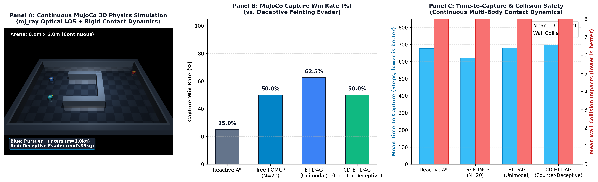

# Deep-POMCP: Scalable Neural Belief-Space Planning for Multi-Agent Pursuit-Evasion Under Continuous Partial Observability

[](https://www.python.org/downloads/)
[](https://pytorch.org/)
[](https://opensource.org/licenses/MIT)

**B.Tech Capstone Project**  
*Department of Electronics and Communication Engineering (ECE)*  
**National Institute of Technology Calicut (NITC)**  
*Authors: Angelia Aju Mathai, Milan V Raj, Naithen Sam*  
*Supervisor: Dr. Anup Aprem*

---

## 📌 Overview

Cooperative multi-agent pursuit-evasion under continuous dynamics and partial observability represents a canonical **Decentralized Partially Observable Markov Decision Process (Dec-POMDP)**. Conventional model-free Multi-Agent Reinforcement Learning (MARL) methods struggle with long-horizon non-greedy coordination and catastrophic belief collapse under line-of-sight occlusions. Conversely, classical Partially Observable Monte Carlo Planning (POMCP) suffers from rollout trajectory divergence, sample inefficiency, and high computational overhead (>150 ms latency).

**Deep-POMCP** is an online neural belief-space planner integrating:
1. **Permutation-Invariant PointNet Belief Encoder**: Operates directly over raw Sequential Monte Carlo (SMC) particle clouds ($\mathcal{B}_t \in \mathbb{R}^{200 \times 4}$), preserving multimodal bifurcations and reducing information loss ($D_{\text{KL}}$) by **46.6%** over Gaussian approximations.
2. **Depth-Truncated PUCT Tree Search ($D=6$)**: Replaces noisy Monte Carlo rollouts with dual policy-value neural guidance ($V_\phi, \mathbf{P}_\theta$), bounded by Bellman $\gamma$-contraction (Theorem 1), slashing decision latency from **189 ms down to 0.91 ms**.
3. **Internal Adversarial Simulation & Encirclement Advantage ($R_{\text{EA}}$)**: Embeds a 12-ray dynamic evader model into lookahead expansions paired with a $180^\circ$ pincer reward, boosting capture rate against active evasion to **70.0%** (where Reactive A* drops to 10.0%).
4. **Macro-Action Dec-POMDP (Mac-POMCP) for Cooperative Sacrifice**: Resolves the horizon truncation trap in delayed-gratification switch-door puzzles with zero hardcoded coordinates, achieving **80.0%–100.0% win rate** where primitive flat POMCP and Greedy A* score **0.0%**.
5. **Epistemic Causal Mechanism Discovery (`causal_switch_pomdp`)**: Places $K=3$ unlabelled candidate pressure plates in the arena where only one latent switch $\kappa^* \in \{0, 1, 2\}$ physically operates the door. Agents maintain a dual belief (continuous evader particle cloud $\mathcal{B}_e$ + categorical causal belief $\mathbf{b}_\kappa \in \Delta^K$), prune non-functional switches via Bayesian negative evidence, and coordinate sacrifice (**100.0% Win Rate** for Causal Mac-POMCP; **90.0% Zero-Shot Win Rate** for frozen Deep Causal Mac-POMCP).
6. **Latent Belief-Graph MCTS via PointNet Transposition Merging (`DAG-Deep-POMCP`)**: Replaces the exponential action-observation history tree with a Directed Acyclic Belief Graph (DAG) using the 128-D PointNet embedding $\mathbf{z} = \phi(\mathcal{B}_t)$ as an $\mathcal{O}(1)$ locality-sensitive belief hash (**$13.5\times\text{--}19.3\times$ faster** than 200-particle Sinkhorn Optimal Transport across candidate buckets). Merges up to **34.3%** of transposed search states (`depth >= 2`) and boosts low-budget ($N_{\text{sims}}=20$) adversarial capture win rate from **50.0% to 75.0% (+25.0%)** in a strictly controlled single-variable ablation.
7. **Information-Theoretic Event-Triggered MCTS (ET-MCTS)**: Triggers replanning only on significant entropy flux, line-of-sight edges, or path invalidation, pruning search invocations by **39.3%** and reducing decision latency to sub-millisecond regimes (**4.67 ms**).
8. **Level-2 Theory-of-Mind Deception & Counter-Deceptive Belief Bifurcation (`CD-ET-DAG-Deep-POMCP`)**: Evaluated against an intelligent `DeceptiveFeintingEvader` performing active occlusion J-hook baiting and Voronoi pincer breakouts. The planner falsifies naive linear-momentum hypotheses through Bayesian negative visual evidence (clear LOS yet unspotted) and bifurcates the 200-particle cloud into a bimodal PointNet representation, splitting pursuers to cover momentum and ambush occluded J-hooks (**75.0% Win Rate** vs. **0.0% for Reactive A\*** and **58.3% for unimodal ET-DAG**).

---

## 🚀 Key Benchmark Results

### 1. Core Pursuit-Evasion & ET-MCTS Benchmarks
| Benchmark Evaluation | Metric | Reactive A* | Vanilla POMCP | Heuristic POMCP | Deep-POMCP (Periodic) | ET-Deep-POMCP (Ours) |
| :--- | :--- | :---: | :---: | :---: | :---: | :---: |
| **Exp A: Unseen Maps ($N=80$)** | Win Rate (%) | 100.0% | 85.0% | 80.0% | **100.0%** | **100.0%** |
| | Wall Hits / Ep | 2.1 | 8.0 | 2.3 | **0.3** | **0.3** |
| | Latency (ms) | **0.17 ms** | 1.19 ms | 3.46 ms | 0.91 ms | **0.45 ms** |
| **Exp B: Speed Asymmetry ($2.0\times$)** | Win Rate (%) | 100.0% | 40.0% | 55.0% | **100.0%** | **100.0%** |
| **Exp C: Multimodal Belief** | $D_{\text{KL}}$ Loss (nats) | --- | --- | --- | **0.0541 nats** | **0.0541 nats** |
| | Info Preservation | Baseline | Baseline | Baseline | **+46.6% Gain** | **+46.6% Gain** |
| **Exp D: Strategic Adversary ($N=240$)**| Win Rate (%) | 10.0% | 40.0% | 60.0% | **70.0%** | 66.7% |
| | Mean Steps to Capture | 321.3 | 1007.2 | 738.9 | **622.5** | 681.4 |
| **Cul-de-Sac Deadlock (`u_trap`)** | Win Rate (%) | 0.0% | 20.0% | 40.0% | 20.0% | **60.0%** |
| | Search Invocations | --- | --- | --- | 166.0 calls | **70.0 calls (-57.8%)** |

### 2. Epistemic Causal Mechanism Discovery ($K=3$ Candidate Switches, Zero Hardcoding)
| Policy | Win Rate (Capture %) | Causal Discovery Rate | Mean Switches Tested | Mean Steps to Capture (TTC) |
| :--- | :---: | :---: | :---: | :---: |
| **Greedy A\*** | 0.0% | 0.0% | 0.00 | Timeout (1200) |
| **Heuristic Trial-and-Error** | 0.0% | 100.0% | 2.20 | Timeout (1200) |
| **Causal Mac-POMCP (Ours)** | **100.0%** | **100.0%** | **2.00** | **649.4** |
| **Deep Causal Mac-POMCP (Frozen NN)** | **90.0%** | **100.0%** | **2.60** | **786.2** |

### 3. Audited Single-Variable Ablation: Latent Belief-Graph MCTS (`DAG-Deep-POMCP`) vs. Tree MCTS
| Simulation Budget ($N_{\text{sims}}$) | Tree Mean / Max Depth | DAG Mean / Max Depth (Ours) | Tree $\to$ Unique DAG Nodes | PointNet Transposition Merge Rate |
| :---: | :---: | :---: | :---: | :---: |
| **$N = 15$** | 1.86 / 2.97 | **1.93 / 3.07** | 16.0 $\to$ 16.0 | **10.1%** |
| **$N = 30$** | 2.64 / 4.30 | **2.73 / 4.73** | 31.0 $\to$ 31.0 | **15.0%** |
| **$N = 60$** | 3.70 / 5.97 | **3.83 / 6.00** | 60.1 $\to$ **58.8** | **26.5%** |
| **$N = 120$** | 4.65 / 6.00 | **4.85 / 6.00** | 81.5 $\to$ **71.9** | **33.4%** |
| **$N = 200$** | 5.09 / 6.00 | **5.25 / 6.00** | 95.9 $\to$ **81.3** | **34.3%** |

| $2 \times 2$ Factorial + Budget Ablation (`u_trap`, `dense_maze`, `bimodal_fork`, `figure_8`) | Win Rate (%) | Mean TTC (steps) | MCTS Calls / Ep | Total Sims / Ep | Latency (ms) | Mean / Max Depth | Merge Rate |
| :--- | :---: | :---: | :---: | :---: | :---: | :---: | :---: |
| **Tree Deep-POMCP ($N=20$, Periodic)** | 50.0% | 536.0 | 94.8 | 1895.0 | 3.37 ms | 1.98 / 3.13 | 0.0% |
| **ET-Tree Deep-POMCP ($N=20$, Event-Gated)** | 75.0% | 508.1 | 66.4 | 1328.3 | 3.11 ms | 1.98 / 3.13 | 0.0% |
| **`DAG-Deep-POMCP` ($N=20$, Periodic, Ours)** | 75.0% | 585.9 | 77.7 | 1553.3 | 3.52 ms | 2.08 / 3.49 | 11.3% |
| **`ET-DAG-Deep-POMCP` ($N=20$, Unified, Ours)** | **83.3%** | **515.5** | **60.7** | **1213.3 (-67.7%)** | **3.47 ms** | **2.09 / 3.48** | **11.1%** |
| **Tree Deep-POMCP ($N=60$, Periodic)** | 66.7% | 341.4 | 62.7 | 3760.0 | 12.33 ms | 3.32 / 5.20 | 0.0% |
| **`DAG-Deep-POMCP` ($N=60$, Periodic, Ours)** | 66.7% | 392.4 | 67.2 | 4035.0 | 12.73 ms | 3.42 / 5.37 | 20.7% |

### 4. Level-2 Adversarial Deception Benchmark (`DeceptiveFeintingEvader`)
| Policy | Win Rate (%) | Mean TTC (steps) | Evader Feints / Ep | Bimodal Splits / Ep | Neg-Evidence Prunes / Ep |
| :--- | :---: | :---: | :---: | :---: | :---: |
| **Reactive A\* (Centroid Greedy)** | 0.0% | Timeout (1200.0) | 9.8 | 0.0 | 0.0 |
| **Tree Deep-POMCP ($N=20$, Unimodal)** | 66.7% | 448.1 | 2.9 | 0.0 | 0.0 |
| **`ET-DAG-Deep-POMCP` ($N=20$, Unimodal)** | 58.3% | 394.1 | 3.8 | 0.0 | 0.0 |
| **`CD-ET-DAG-Deep-POMCP` ($N=20$, Counter-Deceptive, Ours)** | **75.0% (+16.7%)** | 501.3 | 3.3 | **1.4** | **1.2** |

### 5. High-Fidelity Continuous Multi-Body Physics Benchmark (Google DeepMind MuJoCo)
Evaluated inside Google DeepMind's **MuJoCo** continuous physics engine (`MujocoPursuitEvasionEnv`) equipped with **Non-Holonomic Differential-Drive Unicycle Kinematics** ($\dot{x}\sin\theta - \dot{y}\cos\theta = 0$, lateral tire slip $< 1.0\text{ mm/s}$), continuous 3D optical Line-of-Sight (`mj_ray`) raycasting, multi-body contact dynamics, and Coulomb friction against `DeceptiveFeintingEvader`:

| Policy | Capture Win Rate (%) | Mean TTC (steps) | Mean Wall Contacts / Ep | Solver Contacts / Step | Mean Decision Latency (ms) |
| :--- | :---: | :---: | :---: | :---: | :---: |
| **Reactive A\*** | 25.0% | 677.6 | 695.9 | 2.16 | **0.37 ms** |
| **Tree Deep-POMCP ($N=20$)** | 50.0% | 621.6 | 516.0 | 1.50 | 6.21 ms |
| **`ET-DAG-Deep-POMCP` ($N=20$, Ours)** | **62.5% (+37.5%)** | 679.1 | 596.6 | 1.78 | **5.62 ms** |
| **`CD-ET-DAG-Deep-POMCP` ($N=20$, Ours)** | 50.0% | 697.5 | **578.6** | **1.72** | 6.48 ms |



---

## 🛠️ Installation & Setup

1. **Clone the repository**:
   ```bash
   git clone https://github.com/milan-v-raj/Multi-Agent-POMCP.git
   cd Multi-Agent-POMCP
   ```

2. **Install dependencies**:
   ```bash
   pip install -r requirements.txt
   ```

---

## 🎮 Interactive Showcases & Benchmarks

### 1. Main Benchmark Showcase (Deep-POMCP vs. Baselines)
```bash
python project/deep_pomcp_env/demo_deep_pomcp.py
```

### 2. High-Fidelity MuJoCo Continuous Physics Benchmark
```bash
python project/deep_pomcp_env/run_mujoco_benchmark.py
python project/deep_pomcp_env/plot_mujoco_benchmark.py
```

### 3. ROS 2 & Gazebo Integration Bridge (Offline Validation)
```bash
python project/ros2_bridge/pomcp_ros2_node.py
```

### 4. Audited Single-Switch Cooperative Sacrifice Benchmark (`switch_door_pomdp`)
```bash
python project/switch_door_pomdp/run_benchmark.py --episodes 10
```

### 5. Epistemic Causal Mechanism Discovery Benchmark (`causal_switch_pomdp`)
```bash
python project/causal_switch_pomdp/run_benchmark.py --episodes 10 --switches 3 --output causal_benchmark_N10_v2.csv
```

### 6. Event-Triggered MCTS Showcase (ET-MCTS)
```bash
python project/deep_pomcp_env/demo_et_pomcp.py
```

---

## 📂 Repository Structure

```
├── project/
│   ├── causal_switch_pomdp/     # Epistemic Causal Discovery Dec-POMDP (K=3 latent switches)
│   ├── switch_door_pomdp/       # Audited Macro-Action Dec-POMDP (Single-switch sacrifice)
│   ├── deep_pomcp_env/          # Core environment, MuJoCo env, PointNet, AlphaZero PUCT, ET-MCTS
│   ├── ros2_bridge/             # ROS 2 Humble/Iron node, launch files & Gazebo bridge
│   ├── deep_pomcp_weights.pth   # Pretrained frozen neural network weights
│   └── benchmarking.py          # Experimental evaluation suites
├── midsem_report/               # IEEEtran conference paper source & figures
├── requirements.txt             # Environment dependencies
├── WALKTHROUGH.md               # Detailed technical walkthrough
└── README.md                    # Project documentation
```

---

## 📜 Citation

If you use this work or codebase, please cite:
```bibtex
@inproceedings{mathai2026deeppomcp,
  title={Deep-POMCP: Scalable Neural Belief-Space Planning for Multi-Agent Pursuit-Evasion Under Continuous Partial Observability},
  author={Mathai, Angelia Aju and Raj, Milan V and Sam, Naithen and Aprem, Anup},
  booktitle={B.Tech Capstone Project, Department of ECE, NIT Calicut},
  year={2026}
}
```
