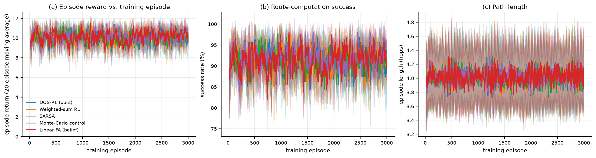
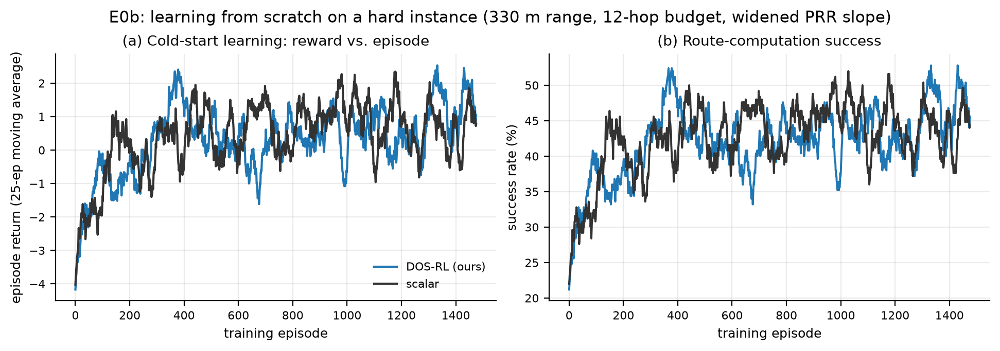
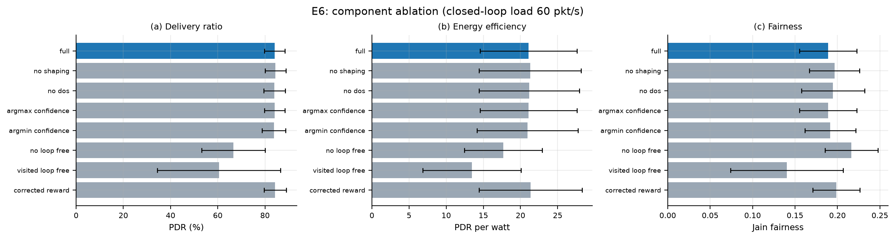
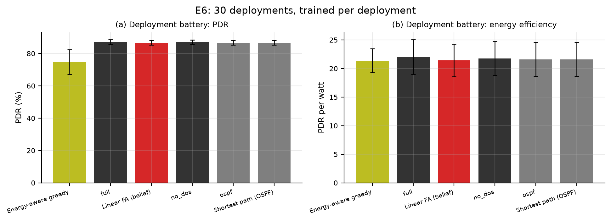
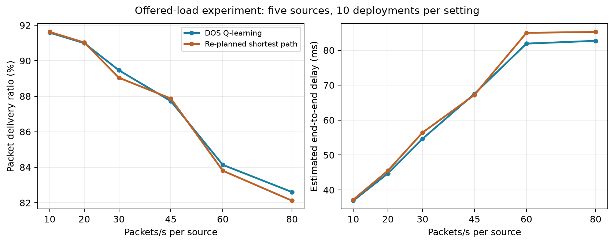

# Reinforcement Learning for Energy-Efficient Routing in Software-Defined Wireless Sensor Networks

**Final project report**  
**Framework paper:** Godfrey et al., *Sensors*, 2023 [1]  
**Implementation and results:** Python simulator and the completed ARQ-corrected network experiment suite

## Abstract

Wireless sensor networks must deliver data reliably while operating with limited battery energy, variable wireless links and finite forwarding buffers. This project applies reinforcement learning (RL) to the selection of packet-forwarding routes in a software-defined wireless sensor network. Following Godfrey et al. [1], the main formulation uses a correlated multi-objective Markov decision process (CMOMDP) with objectives for relay energy, buffer/load and link reliability. A central simulated controller chooses the next hop using value-based dynamic objective selection (DOS) and Q-learning. Weighted-sum Q-learning, SARSA, Monte Carlo and linear-function approximation are also implemented or evaluated.

The report uses the completed ARQ-corrected experiments. Training curves and independent route-episode tests provide evidence of learning, especially on a deliberately harder cold-start task. Network experiments compare the learned policies with shortest-path and static OSPF-like routing and test changes in load, learning rate and link availability. Some settings show favourable descriptive means for the RL policy, but the results do not establish that DOS or reward shaping is consistently superior. The implementation is a paper-inspired flow simulator, not an exact ns-3 reproduction.

## 1. Problem understanding and literature review

### 1.1 Real-life problem and motivation

Consider an environmental monitoring network spread across a large area. Sensors generate measurements that must be forwarded through battery-powered relay nodes to a gateway. A poor choice of route can exhaust relays, congest a buffer or rely on unreliable links. These problems are coupled: the shortest route may repeatedly use the same relays, while avoiding those relays may require more hops or weaker links. Once a relay loses sufficient energy or a link fails, a previously installed path can become unsuitable.

In software-defined wireless sensor networking, control decisions are separated from forwarding. A controller can use network observations to determine forwarding paths. The goal in this project is to learn a next-hop decision policy that balances energy, load and reliability, then evaluate whether it performs usefully under different traffic and network conditions. The application is a **simulated routing problem**, not a deployment of a physical sensor network.

| Project question | Evaluation approach |
|---|---|
| Can RL learn route decisions? | Plot reward against training episodes and evaluate greedy policies on independently sampled route episodes. |
| How does the learned policy compare with alternatives? | Compare Q-learning and SARSA in route tests and compare DOS Q-learning with weighted-sum and classical policies in network simulation. |
| Do design choices and changed conditions matter? | Test shaping, action restrictions, learning-rate changes, offered load and temporary link outages. |
| Does the approach reproduce the framework paper? | Compare model, algorithm and metrics with the paper, explicitly identifying approximations. |

### 1.2 Literature and research basis

Godfrey et al. [1] propose DOS-RL for energy-efficient routing in software-defined wireless sensor networks. They formulate routing using correlated objectives and consider relay energy, buffer/load and link reliability. Their system includes network controllers sharing a network view, reward shaping, routing restrictions and comparisons with OSPF and SDN-Q. They report results for packet delivery, delay and energy efficiency. The present project follows the multi-objective idea and the paper's relay-based state description, while using a simpler simulation and implementation; it must not be presented as an exact replication.

Q-learning [2] is an off-policy method that estimates the value of an action using immediate reward and the best estimated next action. SARSA [3] is an on-policy alternative that uses the next action actually selected by its current policy. Both permit learning from interaction without an explicitly known transition table, though their behaviour and convergence assumptions depend on the state representation, exploration and environment. The comparison is relevant here because the agent must choose between available next hops under stochastic wireless outcomes.

Potential-based reward shaping [4] supplies an additional progress signal of the form `γΦ(s′) − Φ(s)`. It can make feedback more informative without arbitrarily changing the reward in the theorem's setting. The theorem should not automatically be assumed to hold for this project's aliased node-only representation or for every implementation detail. The experiments therefore compare shaped and unshaped configurations rather than asserting that shaping necessarily improves performance.

The research gap addressed here is practical rather than a new theoretical claim: implement and audit a manageable paper-inspired routing model, evaluate several RL approaches, and distinguish empirical observations from claims that require a faithful paper reproduction or stronger statistical evidence.

### 1.3 Relationship to the framework paper

| Aspect | Paper [1] | This project |
|---|---|---|
| Controller | Multiple controllers share a centralized network view. | A single simulated controller computes forwarding decisions. |
| State and objectives | Relay-node states and correlated energy, load and PRR objectives. | Relay ID is the main Q-table key; rescaled versions of the three objectives are used. |
| DOS action selection | Uses a confidence-based formulation with ambiguity between the confidence expression and pseudocode. | Default selector uses the largest estimated objective value; alternative confidence modes are experimental. |
| Routing restriction | Describes an STP-derived routing restriction. | BFS-hop restriction with a geographic fallback; not a literal STP implementation. |
| Simulation and baselines | ns-3 network experiments, OSPF and SDN-Q. | Analytical flow simulator, static OSPF-like and adaptive shortest-path baselines; no SDN-Q implementation. |
| Energy efficiency | Packet delivery divided by average relay energy as described in the paper. | PDR fraction per watt is the principal measure; a paper-style candidate is also calculated but is not claimed to be equivalent. |

The main project is CMOMDP-focused. A partial-observability extension exists separately and is not used to claim a POMDP solution here.

## 2. MDP formulation and reward design

### 2.1 Decision process and state

A route episode starts at a sampled source relay and ends when the gateway is reached or the route fails. It can be described conceptually by `M = (S, A, P, R, γ, T)`, where `S` is the state set, `A` the allowed next-hop actions, `P` the stochastic transition model, `R` the reward vector, `γ` the discount factor and `T` the terminal conditions.

A more complete environment description would include the current relay, all relevant relay energies and buffer loads, link availability and reception probabilities, the visited set and the remaining hop budget. The main tabular agent does **not** store this complete information. Its Q-table key is only the current relay, `s = (i,)`, consistent with the paper's stated relay-state design. Other information still affects rewards and action availability. Consequently, two situations represented by the same key may have different transitions or rewards; the implementation is a compact approximation and is not proven Markov.

| Formulation element | Definition in the main routing experiment |
|---|---|
| Agent | Controller choosing the next relay for a packet. |
| Environment | Wireless relay topology, link availability, energy and load conditions. |
| Q-table state | ID of the relay currently holding the packet. |
| Context outside the key | Eligibility, neighbour and link status, energy, load and episode history. |
| Action | Choose an eligible neighbouring relay or the gateway when it is directly reachable. |
| Objective | Obtain successful routes while considering energy, buffer/load and link reception quality. |

### 2.2 Actions, transitions and episode termination

The agent normally selects from neighbours that are reachable, have an available link and satisfy the relevant energy/eligibility conditions. The default action restriction favours lower breadth-first-search hop distance to the gateway, with a geographic fallback. When the gateway is directly reachable, it is the only action. The restriction reduces the set of choices but is not a literal STP algorithm or an unconditional guarantee of loop-free behaviour in every mode.

For link `(i, j)`, let `p` be the per-attempt reception probability and `R` the maximum number of attempts. Assuming independent attempts, the route-episode model uses `P(success) = 1 − (1 − p)^R`. On success the packet advances to `j`, and the sampled episode snapshot updates energy, load and queue estimates. On failed attempts, the route terminates as a failure. The training route model charges a single hop cost on success; it does not simulate the individual energy of each retransmission.

| Terminal condition | Episode outcome and reward |
|---|---|
| Gateway reached | Successful termination with a `+10` terminal bonus. |
| Energy infeasible | Failure when the sender cannot forward while remaining above the configured energy threshold; normally `−10`. |
| Link failure or dead end | Failure if all attempts fail, the next step has no eligible action, or an invalid action is supplied; normally `−10`. |
| Loop or hop limit | Failure when a relay is revisited or the hop budget is exhausted; normally `−10`. |
| No action at the initial state | The trainer exits without applying a failure update; this is an implementation limitation. |

### 2.3 Multi-objective reward

For a relay-to-relay decision from `i` to `j`, let `e_i` and `e_j` be normalized residual energies, `q_j` the fraction of buffer occupied at `j`, `l_i` the normalized load at `i`, and `p_ij` the estimated link PRR. The default objective vector is:

| Objective | Implemented reward | Design intent |
|---|---|---|
| Energy | `r_E = 0.5 × (1 + e_j − e_i)` | Prefer a next relay with relatively more residual energy. |
| Buffer/load | `r_Q = 0.5 × (1 + (1 − q_j) − l_i)` | Prefer available receiver buffer while accounting for sender load. |
| Link reliability | `r_L = p_ij` | Prefer links with higher estimated reception probability. |

These formulas are rescaled or approximated versions of the paper's objectives, not exact reproductions of every equation. The energy reward uses the snapshot before the hop. In route training, link quality is taken from the distance model; deployed telemetry may be smoothed. For a gateway action, the implementation uses gateway-specific conventions for its energy, buffer and PRR values.

The rewards form a vector `r = (r_E, r_Q, r_L)`. The DOS agent maintains values for the individual objectives and, by default, chooses the objective whose available actions have the highest estimated value. This **value-based** rule is not the paper's confidence rule and is sensitive to reward scale. The weighted-sum baseline instead uses the normalized weighted mean of the objectives; the default weights are equal.

A potential based on progress toward the gateway supplies the shaping term:

`F(s, s′) = γΦ(s′) − Φ(s)`

Here `Φ` increases as the relay approaches the gateway, and terminal potential is set to zero. Q-learning and SARSA receive `r_o + F` for each objective, together with any terminal bonus or penalty. The scalar episode return shown in the plots is the sum of the normalized weighted objective rewards, shaping terms and terminal reward. Since shaped and unshaped rewards differ, their returns alone are not a fair comparison of network outcomes.

### 2.4 Separate expanded-state experiment

The expanded route-snapshot experiment is kept separate from the paper-first relay-state model. It stores additional route-episode context, including energy and load snapshots and history, and is evaluated for the specified fixed-topology route-episode model. It is not a complete state for the physical network or a replacement for the main implementation. Its results and generalisation limitation are reported in Section 4.3.

## 3. Working implementation

### 3.1 Algorithms and procedure

The main method is tabular, value-based DOS Q-learning. For each objective `o`, a simplified non-terminal update is:

`Q_o(s,a) ← Q_o(s,a) + α [r_o + F + γ max_b Q_o(s′,b) − Q_o(s,a)]`

At a terminal step the bootstrap term is omitted and the terminal reward is added to the target. SARSA uses the value of the next action sampled by the current exploration policy in place of the maximum. The implementation also includes an every-visit Monte Carlo controller and a linear Q-function approximator. During training, epsilon-greedy selection balances exploration and exploitation; evaluation uses greedy action selection.

The practical workflow is:

1. Generate a topology and source set, then initialize the routing agent.
2. Sample an episode snapshot, start at a source and select an eligible next hop.
3. Apply the stochastic link outcome, calculate the objective rewards and shaping, and update the learner until the episode terminates.
4. Repeat training, record episode returns and evaluate greedily on a separate random stream.
5. For network studies, install the resulting policy in the flow simulator and compare delivery, delay and energy with other policies under the same scenario seeds.

Network deployment can replan routes as conditions change, but the reported runs use frozen Q-values rather than online RL updates. Replanning should therefore not be described as continual learning.

### 3.2 Simulation and experiment settings

| Setting | Value or method | Interpretation |
|---|---|---|
| Network area | 1,500 × 1,500 m | Nominal paper setting. |
| Relay counts | 30 default; 30, 45 and 60 in density sweep | Topologies are simulated and connectivity is repaired. |
| Nominal relay battery | 5 J | Actual initial energies have a small random spread. |
| Default source traffic | 5 sources, 10 packets/s per source | Some experiments intentionally change source count or load. |
| Packet size; run duration | 512 bits; 200 s | Nominal network-flow settings. |
| Radio range; forwarding threshold | 450 m; 10% nominal energy | Project model choices, not all specified by the paper. |
| Queue | Capacity 20 packets; analytical M/M/1/K approximation | This is not a packet-level ns-3 queue simulation. |
| ARQ | Up to 3 independent transmission attempts | The corrected expected-attempt formula is used in network results. |
| Main network RL | `α = 0.30`, `γ = 0.85`, `ε = 0.30` | Standard epsilon-greedy exploration; no decay in the default network setting. |
| Default route-episode hop limit | 20 | The hard cold-start task separately uses a shorter limit. |

In the flow simulator the expected number of ARQ attempts is `E[N] = Σ(k=0 to R−1) (1−p)^k`, which is used for transmission accounting. Earlier saved network runs used an incorrect expression; the reported suite was rerun after correction. The correction does not resolve other model limitations, including the simplified retry-delay treatment and the difference between source-average and fully delivery-weighted delay.

### 3.3 Implementation, evaluation and reproducibility

| Component | Project location |
|---|---|
| Route formulation, actions and rewards | `dos_rl/mdp.py` |
| Network dynamics, flow and energy | `dos_rl/network_sim.py`, `dos_rl/energy.py` |
| Q-learning, SARSA and Monte Carlo | `dos_rl/agents/tabular.py` |
| Linear approximation | `dos_rl/agents/linear_fa.py` |
| Training and route evaluation | `dos_rl/trainer.py` |
| Separate expanded-state experiment | `full_state_experiment/` |
| Experiment suite and outputs | `run_arq_fixed_suite.sh`, `arq_fixed_suite/` |
| Paper-fidelity and model audit | [PAPER_FIDELITY.md](PAPER_FIDELITY.md) |

Route tests are new episodes with a separate evaluation random stream on the **same topology used for that agent's training**; they are not independent unseen topologies. The E6 network battery uses separate deployment seeds from its ablation but retrains each RL agent on its evaluated deployment. E7 is a separate zero-shot deployment transfer test. Network PDR, delay and energy are flow-model estimates, not empirical packet measurements.

| Verification | Result |
|---|---|
| Regression and formulation unit tests | 20 passed, including three tests for ARQ attempt accounting. |
| Standalone network simulator checks | 19 passed. |
| Full network suite | All experiment, figure and report stages marked complete. |
| Earlier network results | Preserved separately in `corrected_suite/`; they used the old ARQ formula. |

The completed suite's [full tables](arq_fixed_suite/RESULTS.md), [figures](arq_fixed_suite/figures/) and [old-versus-corrected comparison](ARQ_IMPACT.md) provide additional detail. `arq_fixed_suite/run_notes.md` records a wrapper error after the inner runner completed and the successful stage-marker verification on resume. These checks establish execution and regression coverage, not exact agreement with the paper.

## 4. Interpretation of results and RL design

### 4.1 Training reward and independent route tests

E0 trains each agent on the default route task. The evaluation uses new route episodes from a separate random stream, but the deployment is the same one used for training. Values are means across seeds. The table explicitly distinguishes Q-learning from SARSA.

| E0 learner | Training episodes per seed | Test episodes per seed | Seeds | Test success | Mean test return |
|---|---:|---:|---:|---:|---:|
| DOS Q-learning | 3,000 | 30 | 8 | 93.3% | 10.48 |
| Weighted-sum Q-learning | 3,000 | 30 | 8 | 94.2% | 10.67 |
| SARSA | 3,000 | 30 | 8 | 95.0% | 10.84 |
| Monte Carlo | 3,000 | 30 | 8 | 95.0% | 10.85 |
| Linear Q approximation | 3,000 | 30 | 8 | 92.9% | 10.46 |

Every evaluated policy exceeds the assignment's minimum number of independently sampled test episodes per seed. These episodes share a topology within a seed and should not be described as independent network deployments. The task is relatively easy, partly because action restrictions already favour progress to the gateway; high success alone is not proof that one learner is superior.

**Figure 1.** E0 training curves, averaged across seeds; reward is shown as a 20-episode moving average. Shaded intervals describe variation across seeds as plotted by the experiment. The CSV named `e0_curves_raw.csv` also contains smoothed, not raw individual-episode, values.

E0b is a deliberately harder cold-start setting with reduced radio range, more marginal links and a tighter hop budget. The early and late training averages use different windows, and the held-out test is greedy.

| E0b learner | Seeds | Training episodes / seed | Test episodes / seed | Early → late training return | Held-out success | Mean test return |
|---|---:|---:|---:|---:|---:|---:|
| DOS Q-learning | 10 | 1,500 | 30 | −3.30 → 1.38 | 82.0% | 8.88 |
| Weighted-sum Q-learning | 10 | 1,500 | 30 | −2.96 → 0.82 | 79.7% | 8.02 |

**Figure 2.** The cold-start curves show a 25-episode moving average of the seed-averaged training results. Both learners' early-to-late mean return improves in this deliberately challenging task. This is evidence consistent with learning; it is not proof of a statistically significant DOS advantage, and the curves need not improve monotonically.

### 4.2 Which RL design choices helped?

The ablation uses matched deployments at the same offered load. DOS with and without shaping and weighted-sum Q-learning all make use of the route-action restriction; the unrestricted variant changes which actions are available.

| E6 variant | Deployments | PDR | PDR fraction/W | Mean total energy |
|---|---:|---:|---:|---:|
| DOS Q-learning, shaping | 10 | 84.14% | 21.08 | 9.57 J |
| DOS Q-learning, no shaping | 10 | 84.46% | 21.30 | 9.57 J |
| Weighted-sum Q-learning, shaping | 10 | 83.98% | 21.17 | 9.59 J |
| No loop-free action mask | 10 | 66.62% | 17.68 | 8.83 J |

The restricted-action setting has a higher delivery mean than the unrestricted setting in this experiment, which is consistent with preventing unproductive route choices. However, the two variants have different action spaces; the difference cannot be attributed solely to Q-learning. The shaped and unshaped DOS means are close and do **not** establish a shaping advantage. Similarly, the DOS and weighted-sum means do not establish that objective selection is superior.

**Figure 3.** E6 compares routing design variants on matched deployments. The plotted error bars are approximate intervals across deployments, not proof of causal effects.

The separate E6 deployment battery compares learned and non-RL policies. Each RL agent is retrained on the same deployment on which its network run is measured; it is **not** a zero-shot test. `PDR fraction/W` is the mean of per-run PDR divided by average network power, rather than PDR divided by average relay energy.

| E6 policy | Deployments | PDR | Delay | PDR fraction/W | Total energy |
|---|---:|---:|---:|---:|---:|
| DOS Q-learning | 30 | 87.15% | 62.46 ms | 22.02 | 8.65 J |
| Weighted-sum Q-learning | 30 | 87.07% | 61.90 ms | 21.76 | 8.71 J |
| Linear Q approximation | 30 | 86.76% | 61.75 ms | 21.41 | 8.81 J |
| Re-planned shortest path | 30 | 86.68% | 61.47 ms | 21.60 | 8.76 J |
| Static OSPF-like | 30 | 86.68% | 61.47 ms | 21.60 | 8.76 J |
| Energy-aware greedy | 30 | 74.80% | 51.67 ms | 21.37 | 7.50 J |

| Paired comparison | Deployments | Mean PDR difference | Wilcoxon p-value |
|---|---:|---:|---:|
| DOS Q-learning minus shortest path | 30 | +0.46 percentage points | 0.325 |
| DOS Q-learning minus weighted-sum Q-learning | 30 | +0.07 percentage points | 0.607 |

The DOS policy has slightly higher mean PDR and PDR/W than shortest path in this battery, but the PDR test does not establish a difference at the conventional significance threshold. DOS also has a higher mean delay in this comparison. These are scenario-specific simulation results, not proof of a general improvement or paper-equivalent energy efficiency. Multiple comparisons and limited sample size further constrain inference.

**Figure 4.** Network deployment results; RL policies are trained separately on each evaluated deployment. Lower energy consumption by itself is not necessarily better if delivery also falls, as the energy-aware greedy policy illustrates.

### 4.3 Separate expanded-state comparison

| Route-episode state | Seeds | Training episodes / seed | Test episodes / seed | Test success | Test decisions using a previously seen training key |
|---|---:|---:|---:|---:|---:|
| Relay only | 8 | 3,000 | 30 | 91.7% | 1,102 / 1,102 |
| Full route snapshot | 8 | 3,000 | 30 | 90.4% | 0 / 1,095 |

The exact snapshot state contains more context but its keys did not recur in the evaluation decisions. An exact tabular lookup therefore rarely reuses learned values for this representation. The result identifies a generalisation difficulty; it does not prove that the relay-only state is Markov or statistically superior.

### 4.4 Changing an RL parameter

E4 varies the learning rate while other settings for that sweep remain fixed. Unlike the main relay-only experiments, E4's default **congestion mode uses a compact node-plus-energy/buffer-bin state**, so its numbers should not be treated as a pure relay-state comparison. Each setting uses the same set of deployment seeds; the network PDR difference is against re-planned shortest path at the stated offered load. The displayed interval is an approximate mean-difference interval half-width, not a direct test of the difference between learning rates.

| Learning rate α | Seeds | Training episodes / seed | Final training return | PDR difference vs shortest path | Approximate 95% interval half-width |
|---|---:|---:|---:|---:|---:|
| 0.02 | 6 | 2,500 | 10.36 | −0.02 pp | 2.08 pp |
| 0.30 | 6 | 2,500 | 10.32 | +1.41 pp | 1.34 pp |

The higher learning-rate setting has a larger descriptive mean PDR difference in this sample, while the final returns are similar. The intervals overlap and the sample is small, so the experiment does not demonstrate that the higher learning rate reliably improves performance. Other swept parameters are available in the full results.

### 4.5 Changing network conditions

In E2, offered load is varied while using the same number of sources. Higher traffic increases queue pressure and energy use. The table shows scenario means, not a significance test.

| Offered load per source | Deployments | Policy | PDR | Delay | Total energy |
|---|---:|---|---:|---:|---:|
| 10 packets/s | 10 | DOS Q-learning | 91.58% | 36.92 ms | 1.64 J |
| 10 packets/s | 10 | Re-planned shortest path | 91.63% | 37.21 ms | 1.65 J |
| 60 packets/s | 10 | DOS Q-learning | 84.14% | 81.90 ms | 9.57 J |
| 60 packets/s | 10 | Re-planned shortest path | 83.81% | 84.99 ms | 9.61 J |
| 80 packets/s | 10 | DOS Q-learning | 82.60% | 82.71 ms | 12.56 J |
| 80 packets/s | 10 | Re-planned shortest path | 82.12% | 85.26 ms | 12.59 J |

Delivery decreases and delay and energy increase as load rises in these examples. At the higher loads DOS has a slightly higher mean PDR and lower mean delay than shortest path, but the table alone does not establish statistical significance or a universal advantage.

**Figure 5.** Mean delivery and delay for the E2a offered-load sweep, comparing DOS Q-learning and re-planned shortest path. The suite also examines other metrics, source counts and relay densities.

E5 changes link availability through a temporary outage. Post-onset PDR covers the period beginning at outage onset through the end of the run, including recovery; it is not solely the outage interval.

| Condition | Matched deployments | DOS post-onset PDR | Shortest-path post-onset PDR | Mean paired difference | Wilcoxon p-value |
|---|---:|---:|---:|---:|---:|
| 40% transient link outage | 8 | 74.12% | 69.25% | +4.87 pp | 0.078 |

The measured mean favours DOS in this sample, but the paired test does not reach the conventional significance threshold. Route choices can be recomputed after changes, but Q-values remain frozen; this is not evidence of online learning during the outage.

### 4.6 Transfer to new deployments

E7 separately trains on a set of 30-relay deployment instances and evaluates trained models without retraining on new deployment seeds and topology families. The result is a more relevant transfer check than E6, although the models are still tested within the simulator and the tabular agent uses relay IDs as keys.

| Test family | Deployments | DOS tabular PDR | Linear Q PDR | Shortest-path PDR |
|---|---:|---:|---:|---:|
| New 30-relay deployments | 20 | 86.73% | 86.52% | 86.97% |
| New 45-relay deployments | 20 | 87.44% | 87.88% | 87.18% |
| New 60-relay deployments | 20 | 87.76% | 87.62% | 87.77% |
| New 30-relay shorter-range deployments | 20 | 90.24% | 90.72% | 90.82% |

Means vary by family and policy. These descriptive numbers do not demonstrate a consistent transfer advantage over shortest path. Differences in topology, relay indexing, action masks and the simulator's assumptions should be considered before applying the findings to real deployments.

### 4.7 Metrics, correction and limitations

| Paper metric or related measure | Was it calculated? | Qualification |
|---|---|---|
| Network packet delivery ratio | Yes. | A flow-model estimate; equal source rates are used in the main sweeps. |
| Network end-to-end delay | Yes. | Estimated queue and retry delay; not exact delivery-weighted packet delay or a packet-level ns-3 measurement. |
| Network energy efficiency | Partly. | PDR/W is calculated. A candidate PDR percentage divided by mean relay energy is also reported, but paper-equivalent averaging and units are not established. |
| Gridworld reward, energy, path length and obstacle hits | Historical values only. | The optional E1 gridworld was not rerun in the corrected network suite and has known update limitations. |
| Lifetime and fairness | Fairness is an additional project metric. | Jain fairness is not network lifetime; no lifetime claim is substituted for the paper's metrics. |

For the candidate paper-style calculation, the simulator divides each deployment's PDR percentage by its mean relay energy consumption, then averages those ratios. The results below are included for coverage, but their units and averaging have not been confirmed to match the paper.

| E6 policy | Deployments | Candidate PDR % / mean relay energy (J) |
|---|---:|---:|
| DOS Q-learning | 30 | 330.34 |
| Weighted-sum Q-learning | 30 | 326.34 |
| Re-planned shortest path | 30 | 323.98 |
| Static OSPF-like | 30 | 323.98 |

The ARQ correction had a material effect on the estimated network outcomes. The following matched-seed comparison is descriptive, not a significance test. E0/E0b route-episode results do not directly use the flow-level attempt-count formula.

| Example | Earlier ARQ model | Corrected ARQ model |
|---|---:|---:|
| E2 DOS PDR at 60 packets/s/source | 77.19% | 84.14% |
| E2 DOS total energy at that load | 14.64 J | 9.57 J |
| E6 DOS PDR in retrained deployment battery | 82.49% | 87.15% |
| E6 shortest-path PDR in same battery | 79.91% | 86.68% |

Key limitations are the node-only state aliasing, non-paper default DOS rule, simplified analytical radio/queue/flow model, different reward scaling and timing, lack of SDN-Q, and the absence of packet-level or physical-network validation. The compact state and action mask expose different amounts of information, and the model uses connectivity repair and project-specific parameters. Because E6 retrains for each deployment, only E7 addresses transfer. The results should be interpreted as evidence within this implementation, not proof of exact paper replication or broad RL superiority.

### 4.8 Conclusion

The project defines and implements a multi-objective RL routing task with explicit states, actions, stochastic transitions, reward design and terminal conditions. Q-learning and SARSA are implemented and compared, episode-reward plots are provided, and test performance is reported over independent route episodes. Both a learning-rate change and changes in network conditions are examined.

The harder route task shows a clear early-to-late increase in mean training return for both tested Q-learning variants. In network simulation, action restrictions and some RL policies produce favourable descriptive results in selected settings. However, the shaping ablation and paired policy comparisons do not establish a general advantage for DOS or shaping. The strongest conclusion is that the implementation is a working, auditable paper-inspired baseline whose behaviour is sensitive to modelling choices; a packet-level simulator, faithful baselines, better state representation and stronger held-out studies would be needed for broader claims.

## References

[1] D. Godfrey, B. Suh, B. H. Lim, K.-C. Lee and K.-I. Kim, “An Energy-Efficient Routing Protocol with Reinforcement Learning in Software-Defined Wireless Sensor Networks,” *Sensors*, vol. 23, no. 20, 8435, 2023. [https://doi.org/10.3390/s23208435](https://doi.org/10.3390/s23208435).

[2] C. J. C. H. Watkins and P. Dayan, “Q-learning,” *Machine Learning*, vol. 8, pp. 279–292, 1992. [https://doi.org/10.1007/BF00992698](https://doi.org/10.1007/BF00992698).

[3] R. S. Sutton and A. G. Barto, *Reinforcement Learning: An Introduction*, 2nd ed., MIT Press, 2018. [http://incompleteideas.net/book/the-book-2nd.html](http://incompleteideas.net/book/the-book-2nd.html).

[4] A. Y. Ng, D. Harada and S. Russell, “Policy Invariance Under Reward Transformations: Theory and Application to Reward Shaping,” *Proceedings of the 16th International Conference on Machine Learning*, pp. 278–287, 1999.
