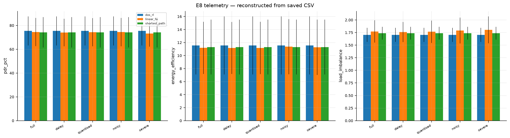

# Optional partial-observability extension (E8)

> **Historical network results:** Values in this document predate the ARQ
> correction. The completed [ARQ-fixed results](arq_fixed_suite/RESULTS.md) and
> [impact comparison](ARQ_IMPACT.md) are separate; see also the
> [fidelity audit](PAPER_FIDELITY.md).


This is a **separate extension**, not the framework paper’s core CMOMDP
formulation. It explores degraded controller telemetry. It is not a complete
POMDP solver or a strictly observation-limited evaluation: real eligibility and
link status still enter action masking. Shared `observer.py` and `belief.py`
are also used in normal deployment with the full profile; separation here does
not change code or historical results.

## Observation model and approximation

With degraded telemetry the controller cannot see `S` directly. A formal
POMDP model would specify the following components (including observation
history in the state where needed); this experiment is only an approximation:

```
M = ( S, A, P, R, Ω, O, γ )
```

### 3.1 Observation model `Ω(o_t | s_t)`

Per routing epoch (`route_lifetime = 3 s`, paper Sec. 3.2.2), the controller
receives a report per relay and per link:

| Quantity | Degradation | Parameter |
|---|---|---|
| residual energy | quantisation to 5 %, Gaussian noise `σ_E`, report loss | `quant_energy`, `noise_energy`, `loss` |
| queue occupancy | Gaussian noise `σ_Q` | `noise_load` |
| link PRR | EWMA over recent frames, then noise `σ_P` | `prr_ema`, `noise_prr` |
| all of the above | delayed by `D` routing epochs | `delay_epochs` |

The named profiles vary these settings; the severe profile combines them.
Noise parameters are Gaussian standard deviations, not hard ± bounds. The
model is a synthetic telemetry channel, not measured field data.

> **Implementation:** `dos_rl/observer.py` (`ControllerObserver`, `OBS_PROFILES`)

### 3.2 Belief state `b_t`

```
b_t ≈ { Ê_i, Q̂_i, load_i, P̂RR_ij, P(alive_i),
        energy variance_i, load variance_i, PRR variance_ij, observation age_i }
```

updated by EWMA with rate `β = 0.35` on every observation. This is an approximate
feature summary, not an exact Bayesian posterior and not a proven sufficient
statistic. The delayed observation model is history-dependent; a formal POMDP
must include the observation-channel history in its state.

`BeliefTracker` uses EWMA updates for its telemetry estimates. Separately,
`TabularAgent` tracks an EWMA of squared TD errors for each objective; that is
not an exact Bayesian posterior or guaranteed statistical confidence.

> **Implementation:** `dos_rl/belief.py`

### 3.3 Policies on the belief

| Agent | Value function | Belief use |
|---|---|---|
| Tabular Q-learning | `Q_o(z,a)` with `z = i` (default) | belief influences rewards and eligibility; optional local bins alter the key |
| Linear FA | `Q_o(b,a) = θ_oᵀφ(b,a)` | selected per-action belief features |
| Network single-objective control | `Q(z,a)` for the first reward component | as for tabular Q-learning; historically mislabeled weighted-sum |

Belief features (`BeliefState.node_features`):

```
φ(b, i→j) = [1, Ê_j, Ê_i, Q̂_j, load_j, load_i, P̂RR_ij, P(alive_j), σ²_E,j, age]
```

For the historical E8 runs, gateway action `j = -1` indexed the last relay's
arrays. Current code instead uses dedicated gateway features, and the linear
update was corrected; old E8 data have not been rerun. The shared linear form
allows zero-shot transfer to be attempted (E7):
`θ` is shared across nodes, whereas the paper's table is `O(N²k)` and is
recomputed per (src,dst) pair.

---


## E8 results




Telemetry degrades from perfect to severe (up to 6 s delay, 5 % quantisation,
8 % noise standard deviation, 15 % report loss). PDR % by profile:

| Profile | DOS-RL | linear FA | BFS |
|---|---|---|---|
| full | **75.4** | 74.4 | 74.2 |
| delay | **75.4** | 74.1 | 74.2 |
| quantised | **75.4** | 74.3 | 74.2 |
| noisy | **75.4** | 74.4 | 74.2 |
| severe | **75.4** | **73.2** | 74.2 |

**The tabular DOS-RL is flat to one decimal place across these profiles**
(75.4 %). The node-only Q-table does not directly encode telemetry, but its
action mask and online updates can be affected by observations, so flatness
does not prove it is insensitive. Linear FA changes from 74.4 % to 73.2 %;
these descriptive results do not establish significance. Because true link and
eligibility information is used during masking, E8 is not a fully
observation-limited robustness test.


Run E8 with `python -m experiments.e8_partial_observability`; the CSV is `results/e8_partial_observability.csv`.
