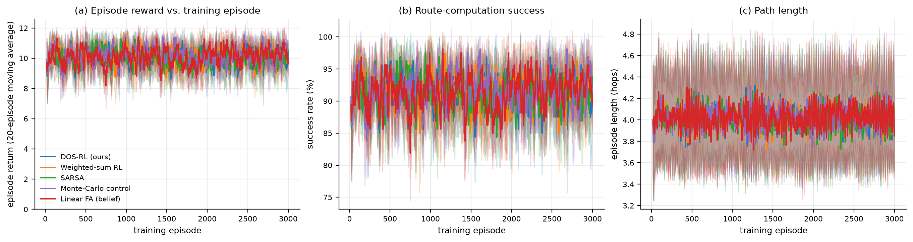
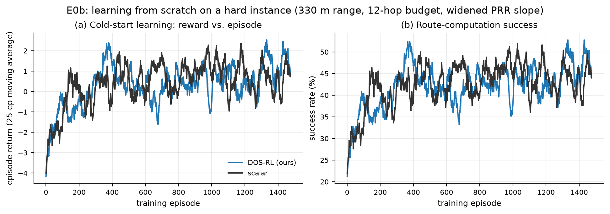

# CMOMDP routing: project report

> **ARQ correction:** The full network suite was rerun with the corrected
> expected attempt count. Earlier `corrected_suite/` network CSVs are preserved
> as historical; see the [measured impact](ARQ_IMPACT.md) and
> [fidelity audit](PAPER_FIDELITY.md).

This report uses the **ARQ-fixed network suite**, completed separately from the
historical results. Full tables are in [arq_fixed_suite/RESULTS.md](arq_fixed_suite/RESULTS.md);
the before/after comparison is in [ARQ_IMPACT.md](ARQ_IMPACT.md).

## 1. Problem understanding and literature

A software-defined wireless sensor network forwards data through battery-powered
relays to a gateway. A simulated central controller chooses next hops while
balancing energy, congestion and link reliability. The paper instead describes
multiple network controllers sharing a centralized view. Static routes can become unsuitable
when network conditions change.

The framework paper by Godfrey et al. describes this as a **correlated
multi-objective Markov decision process (CMOMDP)** and proposes Dynamic
Objective Selection RL. This project uses a custom flow-level simulator, not
the paper's ns-3 implementation, so its results are not an exact reproduction.
The optional partial-observability study is separate: [POMDP_EXTENSION.md](POMDP_EXTENSION.md).

## 2. CMOMDP formulation and reward design

| Component | Main implementation |
|---|---|
| State | Current relay `(node,)`, matching the paper's state description. It is an approximation: network conditions affecting rewards and actions are not all in the key. |
| Action | Select an eligible next-hop relay, or the gateway when directly reachable. The default mask normally favours lower BFS hop counts, with a geographic fallback; it is not a literal STP implementation. |
| Transition | A packet moves if one of the permitted ARQ attempts succeeds; otherwise it is lost. The episode snapshot updates after a successful hop. |
| Rewards | Three normalized objectives: energy difference, available buffer minus sender load, and link PRR. See [MDP.md](MDP.md) for formulas and paper differences. |
| Shaping | `F = γφ(s′) − φ(s)`, with terminal potential set to zero, is included in the corrected learning updates. |
| Terminal | Gateway success gives a bonus; failure transitions generally give a penalty. An initial state with no available action exits without a failure update. |
| DOS | The chosen default selects the objective with the largest estimated Q-value. It does **not** select by certainty. |

The separately tested full route-snapshot state is complete only for the
specified fixed-topology route-episode model, not the entire physical network.
The [paper/code comparison](CMOMDP_COMPARISON.md) distinguishes the paper's
formulas from the user's proposed alternatives and from this implementation.

## 3. Working implementation

The corrected network learner scalarises all objective rewards for the
weighted-sum baseline and includes shaping in Q-learning and SARSA updates. The
linear learner's bootstrap and gateway features were also corrected before the
new runs. Historical results are retained separately, not silently relabelled.

| Component | Location |
|---|---|
| Routing model and simulator | `dos_rl/mdp.py`, `dos_rl/network_sim.py` |
| Q-learning, SARSA and Monte Carlo | `dos_rl/agents/tabular.py` |
| Training and evaluation | `dos_rl/trainer.py` |
| Separate full-state experiment | `full_state_experiment/` |
| ARQ-fixed full network run | `run_arq_fixed_suite.sh` |
| Regression checks | `tests/test_implementation_audit.py`, `tests/test_formulation.py`, `tests/test_network_sim.py`, `full_state_experiment/test_full_state.py` |

The listed regression suites, plus `tests/test_paper_fidelity.py`, passed:
**39 checks**. Their success does not by
itself prove the simulation reproduces the paper.

## 4. Results and interpretation

### Learning and independent route tests

Each trained agent was evaluated greedily on a separate random stream on the
same deployment used for training. All quantities below are seed means.

| Experiment | Training per seed | Test episodes per seed | Seeds |
|---|---:|---:|---:|
| E0 default network | 3,000 | 30 | 8 |
| E0b harder cold-start task | 1,500 | 30 | 10 |

| E0 learner | Test success | Mean test return |
|---|---:|---:|
| DOS Q-learning | 93.3% | 10.48 |
| Weighted-sum Q-learning | 94.2% | 10.67 |
| SARSA | 95.0% | 10.84 |
| Monte Carlo | 95.0% | 10.85 |
| Linear approximation | 92.9% | 10.46 |

On the easy default task all policies have high success; these descriptive
means do not establish a significant ranking.

The saved E0 curves are **20-episode moving averages**, not individual raw
rewards. On the harder task, first-to-last training reward improved for both
learners, but not necessarily monotonically.

| E0b learner | Mean training return, first 50 → last 100 | Test success | Mean test return |
|---|---:|---:|---:|
| DOS Q-learning | −3.30 → 1.38 | 82.0% | 8.88 |
| Weighted-sum Q-learning | −2.96 → 0.82 | 79.7% | 8.02 |

These results indicate learning on the harder instance, not proof that DOS is
better than weighted scalarisation.

### Separate expanded-state comparison

| State key | Seeds | Training episodes per seed | Test episodes per seed | Test success | Evaluation decisions with a previously seen key |
|---|---:|---:|---:|---:|---:|
| Relay only | 8 | 3,000 | 30 | 91.7% | 1,102 / 1,102 |
| Full route snapshot | 8 | 3,000 | 30 | 90.4% | 0 / 1,095 |

Exact snapshot keys did not recur during evaluation, so the expanded-state
policy generally uses untrained values. This is a representation limitation,
not a statistically established performance comparison.

### Network performance and shaping

The E6 ablation compares matched deployments under the same offered load using
the corrected ARQ attempt model.

| Variant | Deployments | PDR | Energy efficiency (PDR fraction/W) |
|---|---:|---:|---:|
| DOS Q-learning with shaping | 10 | 84.14% | 21.08 |
| DOS Q-learning without shaping | 10 | 84.46% | 21.30 |
| Weighted-sum Q-learning with shaping | 10 | 83.98% | 21.17 |
| No loop-free action mask | 10 | 66.62% | 17.68 |

The shaping difference is small in these means; the table does not establish
its significance. The action-mask comparison changes the set of available
routes, so it does not isolate an effect of RL alone.

In the separate E6 deployment battery each RL agent is retrained on its test
deployment. The existing energy-efficiency measure is **PDR fraction per watt**,
not directly the paper's PDR divided by mean relay energy.

| Policy | Deployments | PDR | PDR fraction/W | Mean total energy (J) |
|---|---:|---:|---:|---:|
| DOS Q-learning | 30 | 87.15% | 22.02 | 8.65 |
| Weighted-sum Q-learning | 30 | 87.07% | 21.76 | 8.71 |
| Re-planned shortest path | 30 | 86.68% | 21.60 | 8.76 |
| Static OSPF-like | 30 | 86.68% | 21.60 | 8.76 |

The mean delivery gap between DOS and shortest path is small; the paired test
does not establish a PDR advantage. DOS has a higher mean PDR/W in this sample,
but this is not the paper's metric or proof of a general advantage. A candidate
paper-style metric and complete results are in [RESULTS.md](arq_fixed_suite/RESULTS.md).

| E6 DOS vs shortest path | Paired deployments | Mean PDR difference | Wilcoxon p |
|---|---:|---:|---:|
| ARQ-fixed battery | 30 | +0.46 pp | 0.325 |

## 5. Parameter or environmental change

The E4 parameter sweep changed the learning rate while keeping the remaining
experiment settings fixed. Its final training return and deployment PDR gain
versus its baseline are descriptive, and the intervals overlap.

| Learning rate α | Seeds | Mean final training return | PDR difference vs baseline (pp, approximate 95% CI half-width) |
|---|---:|---:|---:|
| 0.02 | 6 | 10.36 | −0.02 ± 2.08 |
| 0.30 | 6 | 10.32 | +1.41 ± 1.34 |

The E5 study changed link availability using a transient outage. `Post-onset`
means from the start of the outage to the end of the run, including recovery.

| Condition | Deployments | DOS post-onset PDR | Re-planned shortest-path post-onset PDR | Paired difference | Wilcoxon p |
|---|---:|---:|---:|---:|---:|
| 40% link outage | 8 | 74.12% | 69.25% | +4.87 pp | 0.078 |

The corrected outage comparison does not reach the conventional significance
threshold. It supersedes the older report's claim based on the historical code.

## Limitations

| Paper metric | Coverage in this project |
|---|---|
| Network packet delivery ratio | Estimated by the flow model, rather than measured from ns-3 packets. |
| Network end-to-end delay | Estimated queue and retry delay; not exact delivery-weighted packet delay. |
| Network energy efficiency | PDR/W is reported, plus a candidate PDR/mean-relay-energy calculation; the latter's averaging and units are not confirmed as paper-equivalent. |
| Gridworld reward, energy, path length and obstacle hits | Historical E1 results exist, but known update defects remain and E1 was not rerun in this network suite. |

- The relay-only key aliases network situations, and the action mask has access
  to simulator eligibility/link status. Neither guarantees full Markov state.
- The implementation approximates the paper's routing restriction and uses a
  different simulator; the paper's SDN-Q baseline is not implemented.
- E6 evaluates deployments after training on each one; it is not a zero-shot
  topology test. E7 separately tests transfer to unseen deployments.
- The gridworld and telemetry extension were not rerun as part of this core
  network suite. Historical results and their known defects are labelled.
- Statistical power is limited and results do not prove a general advantage for
  DOS or reward shaping. Reported energy efficiency differs from the paper's.

**Reference:** Godfrey et al., “An Energy-Efficient Routing Protocol with
Reinforcement Learning in Software-Defined Wireless Sensor Networks,”
*Sensors* 2023, 23, 8435. [doi:10.3390/s23208435](https://doi.org/10.3390/s23208435).
