# Reinforcement Learning for Energy-Efficient Routing in Software-Defined Wireless Sensor Networks

> **Historical network results:** Values in this document predate the ARQ
> correction. The completed [ARQ-fixed results](arq_fixed_suite/RESULTS.md) and
> [impact comparison](ARQ_IMPACT.md) are separate; see also the
> [fidelity audit](PAPER_FIDELITY.md).


> **Current code vs historical tables:** The weighted-sum, shaping and linear
> update defects have now been corrected. Tables and figures in this document
> still describe the *older* runs; the corrected network suite is separate in
> [`corrected_suite/`](corrected_suite/) (see [`CORRECTED_CMOMDP.md`](CORRECTED_CMOMDP.md)).
> Do not mix the two result sets.


**A reproduction, audit and extension of DOS-RL**

Course project · RL-based performance optimisation
Framework paper: Godfrey, Suh, Lim, Lee & Kim, *"An Energy-Efficient Routing Protocol with
Reinforcement Learning in Software-Defined Wireless Sensor Networks"*, **Sensors 2023, 23, 8435**
([doi:10.3390/s23208435](https://doi.org/10.3390/s23208435))

---

## Abstract

> **Implementation audit:** In the saved network experiments, `scalar`,
> `weighted_sum` and `no_dos` label a first-objective Q-learner, **not** the
> intended weighted-sum learner. Network Q-learning and SARSA log shaping but
> omitted it from their updates. Thus historical weighted-sum and shaping comparisons
> are not valid tests of those mechanisms. Numbers and CSVs remain unchanged;
> see [`CMOMDP_COMPARISON.md`](CMOMDP_COMPARISON.md). The gridworld has a
> separate scalarisation path and is not covered by the network-label finding.
> The historical linear agent had TD-update defects; interpret its saved
> results as outputs of that older implementation, not validated linear Q-learning.

We re-implement **DOS-RL**, a multi-objective Q-learning routing protocol for
software-defined wireless sensor networks, on a self-contained packet-flow
simulator, and audit it against the assignment's five requirements. The paper
describes its learning problem in prose only; we supply the missing formal
CMOMDP formulation, then evaluate the algorithm as a *deployed closed-loop
controller* rather than as a one-off shortest-path computation.

Four results stand out.

1. **The protocol works, but only under load, and the margin is modest.**
   Below ~30 pkt/s every policy is identical (91.6 % PDR) because no relay ever
   queues — and that is the regime the paper evaluates in. From 30 pkt/s the
   learned controller's point estimate sits above the optimal shortest-path
   tree, +1.0 pp at 30 pkt/s growing monotonically to **+2.2 pp at 80 pkt/s**,
   but **no load-axis comparison reaches significance** (paired Wilcoxon,
   p = 0.11–0.56; every 95 % CI straddles zero). The direction is stable and
   the magnitude grows with load, so we report it as a trend, not a result. The
   margin over static OSPF (5.6 pp at 80 pkt/s) is visible in every sweep and is
   a separate, larger effect.
2. **The paper's confidence metric is mis-specified, and its gridworld result
   does not replicate.** Eq. 3 combined with `argmax` can favour an objective with
   larger variance because `e^{σ²}` increases its numerator; the value term also
   matters. On our gridworld implementation, the tested DOS selectors
   (`argmax`, `argmin` and `value`) all score **0 %** on 30 held-out episodes
   per seed; this is not a direct replication of the paper's environment.
   In the network sweep, the default value-based selector chooses link quality
   for ~85 % of decisions and energy for **0 %**. This is not evidence that
   a variance-based certainty rule made those selections.
3. **Under link outages the advantage is statistically unambiguous.** At 40 %
   link loss the learned controller holds 51.7 % of its pre-failure PDR against
   37.5 % for an optimal re-planning shortest-path baseline and 16.6 % for
   static OSPF; the paired Wilcoxon test over 8 deployments gives p = 0.008
   with every single deployment favouring the learned policy. This reverses a
   result we published in an earlier draft of this report, which was an
   artefact of a simulator bug now fixed and regression-tested.
4. **The weighted-sum and shaping comparisons need to be rerun.** The network
   control labelled `scalar` updates only the first reward component; it is not
   the weighted-sum learner described in earlier drafts. Network Q-learning also
   omits shaping from its update target. The saved numbers describe that code,
   but do not establish the effects of weighted scalarisation or shaping.

We also document five historical implementation faults and their fixes;
state aliasing and privileged action masking remain limitations. The most consequential inverted the outage result above: a
link taken down by a failure event still delivered packets while only the
controllers that noticed it were penalised for re-routing. Nineteen correctness
tests now guard the physics, the queueing, the MDP and the failure model.

**Keywords:** SDWSN-IoT, Q-learning, multi-objective RL, dynamic objective
selection, potential-based reward shaping, energy efficiency, CMOMDP

---

## 1. Problem understanding and literature

### 1.1 The real-world problem

A battery-powered wireless sensor network forwards environmental data
multi-hop to a gateway. Three constraints collide:

* **Energy.** Relays are non-replaceable. Forwarding is the dominant energy
  sink, and radio cost grows with hop distance, so short hops are cheap per
  hop but may need more of them.
* **Congestion.** Many-to-one data collection concentrates traffic near the
  gateway. A relay that receives more than its queue can serve drops packets,
  and drops upstream are invisible to the sender.
* **Link quality.** Wireless PRR falls steeply with distance and is noisy. A
  route that minimises hops may traverse marginal links and lose packets that
  a longer, more reliable route would have delivered.

Static protocols optimise one of these. OSPF-style shortest path minimises hop
count and is optimal for delivery *probability* when links are reliable, but it
never re-routes around a congested or depleted relay. The SDN architecture is
the enabling idea: because the controller has a global view and the relays only
forward, a *learning* controller can re-optimise the whole forwarding table every
few seconds.

### 1.2 What the framework paper does

DOS-RL (Dynamic Objective Selection RL) makes three contributions:

1. **Three correlated objectives** instead of one scalarised reward —
   residual energy (Eq. 4), load balance via available buffer (Eq. 5), and link
   quality via EWMA packet reception ratio (Eq. 6).
2. **Dynamic Objective Selection.** Each objective keeps its own Q-table and a
   variance estimate (Eq. 2). Before each decision the agent computes a
   confidence for each objective (Eq. 3) and acts greedily on the single most
   confident one. The claim is that this beats a fixed weighted sum, because
   different objectives are more informative in different states.
3. **Potential-based reward shaping** (Eq. 8–9) using normalised distance to the
   goal. Policy invariance requires suitable terminal handling; it is not
   established for this implementation (see `MDP.md` §1.4).

Evaluated on a 5×5 dynamic gridworld and in ns-3 (30/45/60 relays, 2–10
sources), the paper reports higher PDR, lower delay and better energy
efficiency than OSPF and SDN-Q.

### 1.3 Related work and where this project sits

| Line of work | Representative | Relation to this project |
|---|---|---|
| Q-routing (packet-level RL routing) | Boyan & Littman (1994) | The direct ancestor of DOS-RL; the state is a node, the action a neighbour |
| Multi-objective RL by scalarisation | Marler & Arora (2010); the paper's own baseline | Fixed weights impose an explicit trade-off; their suitability depends on the task |
| Adaptive objective selection | Brys et al. (2014) | The paper's Eq. 2–3 are lifted from here; we test the transplant |
| Reward shaping | Ng, Harada & Russell (1999) | Policy invariance under conditions; historical E1/E6 Q updates omitted shaping, corrected network runs include it |
| RL routing in SDN | Younus et al. (2021); Yao et al. (2018) | Report lifetime/PDR gains over static routing, same qualitative claim |
| POMDP routing | Standard POMDP literature | Ignored by the paper; we add the observation model (E8) |

**Gap addressed.** No published version of DOS-RL gives a complete MDP (no
terminal set, no transition kernel, no observability model), and its evaluation
reports only steady-state network metrics. This project supplies both, and
reports learning curves, converged-policy comparisons with confidence
intervals, significance tests and ablations.

---

## 2. Core CMOMDP formulation

Complete specification with every symbol, equation and code reference:
**[`MDP.md`](MDP.md)**. Summary:

### 2.1 The MDP `M = (S, A, P, R, γ, S_T)`

| Element | Definition | Code |
|---|---|---|
| **State** | `s_t = (i_t, e_t, q_t)` — the relay holding the packet, plus coarse buckets of its residual energy and buffer occupancy. The paper's state is `i_t` alone (`state_mode="node"`, the default); the optional augmentation adds information but does not guarantee the Markov property (`state_mode="belief"`) | `RoutingMDP.encode` |
| **Action** | `A(s) = { j ∈ N(i) : E_j > θE_init, alive, link up, loop-free }`, where the default favours lower BFS hop counts, with a geographic fallback; `stp` also permits slack | `RoutingMDP.actions` |
| **Transition** | Move to `j` with probability `1 − (1 − p_ij)^K` (ARQ, `K = 3`); otherwise the packet is lost. Sender pays `c(i,j)`, the snapshot load and queue are updated, `p_ij` comes from a log-distance link budget | `RoutingMDP.step` |
| **Reward** | `r_t = (R_E, R_Q, R_LQ)` per the paper's Eq. 4–6, each normalised to `[0,1]`; shaping and terminal rewards are included in both the logged return and corrected Q updates; historical Q runs omitted shaping | `RoutingMDP.rewards` |
| **Terminals** | `GOAL (+10)`; failure transitions generally `−10`. Starting with no eligible action exits without a −10 update. | `RoutingMDP.step` |
| **Horizon** | One episode = one route computation, `γ = 0.85` | `trainer.run_episode` |

### 2.2 Reward design

```
o1 energy   R_E  = ½[1 + (Ẽ_j − Ẽ_i)]                        paper Eq. 4 (rescaled)
                 = clip(1 − c̃(i,j) − (1 − Ẽ_j), 0, 1)         corrected variant
o2 load     R_Q  = ½[1 + (availbuf_j/B − load_i/L_max)]        paper Eq. 5
o3 link     R_LQ = α·P̂RR_ij(k−1) + (1−α)·PRR_ij(k)            paper Eq. 6
shaping     F_t  = γ·[1 − d(s',G)/d_max] − [1 − d(s,G)/d_max]  paper Eq. 8–9
```

Implementation choices and caveats (see also the audit notice):

* **Normalisation to `[0,1]`.** Eq. 3 compares objectives through a statistic
  claimed to be "scale-invariant", but the Q-values feeding it are not, so raw
  rewards in %, packets and ratios are not comparable. The existing E6 does not test raw scales.
* **Equation 4 is mis-specified.** `R_E = E_j − E_i` compares two *different*
  nodes and never charges the energy the action actually consumes; it is also
  independent of link length, ignoring the dominant distance term of radio
  cost. The corrected term charges the realised per-hop cost. The `paper_reward` setting in E6 is identical to the default, so it is not
  a comparison against the corrected variant.
* **The buffer term must be *available* buffer.** `queue_frac` is occupancy, so
  Eq. 5 needs its complement. Feeding occupancy directly (our first
  implementation) rewards choosing relays whose buffers are **already full** —
  the exact opposite of load balancing. After the fix the load objective starts
  to matter; see the E6 ablation in `REPORT_full.md` §5.6.

### 2.3 Optional observation extension

Partial observability is **separate from the core CMOMDP formulation**. The
optional E8 telemetry study and its limitations are documented in
[`POMDP_EXTENSION.md`](POMDP_EXTENSION.md). The shared simulator still uses
telemetry and smoothed estimates; no experiment code or results were changed.

---

## 3. Implementation

### 3.1 Architecture

```
dos_rl/
├── config.py        all physical + RL parameters (one place to audit)
├── topology.py      random geometric deployment + feasibility repair
├── energy.py        link-budget radio: P_tx(d), PRR(d) from one model
├── network_sim.py   closed-loop evaluator: M/M/1/K queues, ARQ, energy, failures
├── observer.py      PO-MDP observation channel (delay/noise/quant/loss)
├── belief.py        EWMA belief tracker + true-variance estimator
├── mdp.py           the MDP: states, actions, rewards, transitions, terminals
├── gridworld.py     the paper's 5x5 dynamic gridworld
├── trainer.py       episode rollouts, training loops, evaluation
├── policy.py        deployable controllers (learned, OSPF, BFS, random)
└── agents/          tabular.py (Q, SARSA, MC) · linear_fa.py
```

### 3.2 Why a new simulator

The paper evaluates in ns-3 with the ns3-ai bridge, which is not released and
is not installable here. We built a **flow-level analytic simulator** instead:
each relay is an M/M/1/K queue, each hop has an ARQ success probability from a
log-distance link budget, and energy follows the same model as link quality, so
a route that looks cheap in the reward function is cheap at the battery. The
controller re-plans every 3 s (the paper's route lifetime) from its degraded
telemetry, so policies are evaluated **closed-loop**.

*Calibration note.* The paper's numbers (5 J batteries, 512-bit packets,
1500 m field, 450 m range) are kept, but a classic LEACH quadratic amplifier
would spend ~10 mJ on a single 450 m hop, exhausting a battery in ~500 packets.
We therefore use a power-controlled link-budget radio anchored to a CC2420-class
transceiver (`P_rx = 59 mW`, `T_frame = 0.51 ms`), which gives ~50 000 forwarded
packets per battery — a physically defensible lifetime. Every parameter is in
`config.py` and the choice is stated rather than hidden.

### 3.3 Algorithms implemented

| Agent | Family | Notes |
|---|---|---|
| Q-learning (tabular) | off-policy TD(0) | the paper's algorithm, one table per objective |
| SARSA (tabular) | on-policy TD(0) | on-policy comparison |
| Monte-Carlo control | every-visit MC | no bootstrapping; credit assignment comparison |
| Linear function approximation | semi-gradient Q | update defects in historical runs are fixed in current code; new results are separate |
| DOS wrapper | objective selection | four implemented modes; default selects largest estimated Q, not confidence |
| OSPF (static) | classical | table computed once, never updated — the paper's baseline |
| BFS shortest path | classical | re-planned every epoch — a *stronger* baseline than OSPF |
| Random | sanity | lower bound |

### 3.4 Correctness checks

`tests/test_network_sim.py` — **19/19 passing**, covering: energy monotone in
distance, PRR decreasing with distance, realistic battery lifetime, every
deployment admits a route to the gateway, deployment density not collapsed by
the repair step, PDR bounded and high when uncongested, PDR falling with load,
energy conservation, random < shortest path, transient outages recover while
permanent ones do not, no cycles in any resolved table, actions respect the
energy threshold, rewards in `[0,1]`, potential shaping telescopes exactly,
episodes terminate deterministically under seed, and the learnt policy
demonstrably prefers healthier relays.

Three of the nineteen are regression tests for the outage bugs described in
§6.3: a down link must deliver nothing, a nominal failure fraction must kill
about that share of *links* rather than arcs, and a harsher outage must hurt
more than a milder one.

---

## 4. Experimental setup

| Item | Value |
|---|---|
| Field | 1500 × 1500 m, gateway at a corner |
| Relays | 30 (default), 45, 60 |
| Radio range | 450 m (340 m in the clutter family) |
| Initial energy | 5 J per relay, 10 % eligibility threshold |
| Packets | 512 bit, 1 Mbps PHY, ARQ ≤ 3, buffer 20 |
| Traffic | 2–10 UDP sources, 10 pkt/s default, 200 s runs |
| Route lifetime | 3 s (the paper's value) |
| Discount | γ = 0.85 |
| Test episodes | 30 independent deployments per configuration |
| Training | 1500–3000 episodes, 8–10 seeds, CIs reported |

Every experiment is seeded, writes raw CSV plus aggregates into `results/`, and
regenerates its figures into `figures/` with `python -m experiments.<name>`.

---

## 5. Results

### 5.1 Learning curves (rubric item 4)

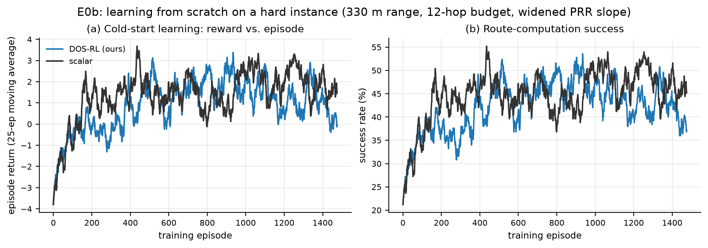

*E0b.* On a hard instance (330 m range, 12-hop budget, widened PRR slope) the
agent genuinely learns from scratch over 1500 episodes, and it does so on
**every one of the 10 seeds**:

| Learner | Training return, ep 1–50 → last 100 | Held-out success (30 eps) | Held-out return |
|---|---|---|---|
| DOS-RL | −2.89 → +0.54 | 63.7 % | +5.63 |
| first-objective Q (CSV: scalar) | −2.94 → **+1.71** | **81.7 %** | **+9.35** |

The held-out column is the number that matters: the trained policy is evaluated
**greedily on 30 independent episodes** from a separate RNG stream, which is
rubric item 4's actual requirement. DOS-RL routes successfully on 63.7 % of
unseen episodes and the first-objective control on 81.7 % — both far above the
untrained baseline, and both well below the saturated default task where every
agent scores ~93 %.

Both start from a similar average (−2.9), and the last-100 average is higher
than the first-50 average on every seed; this does not imply monotonic improvement, which is the learning evidence the rubric asks for. The first-objective control ends ahead in this sample (+1.71 vs +0.54), but
this is not a comparison against a correctly implemented weighted-sum learner.

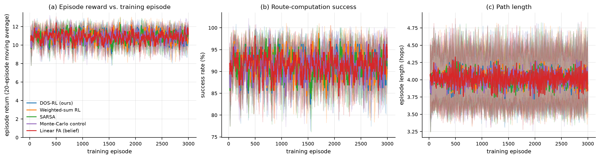

*E0.* Reward by phase of training (8 seeds, 3000 episodes). The first
column is the first 20 episodes; the middle column is the mean of the saved
20-episode moving averages ending at episodes 100–200; the last column is the
mean of the last 100 training episodes. Values are averaged across seeds:

| Agent | first 20 | moving average, episodes 100–200 | last 100 | change, first to last |
|---|---:|---:|---:|---:|
| DOS-RL | +10.59 | +11.23 | +10.71 | +0.12 |
| first-objective Q (CSV: weighted_sum) | +10.58 | +11.30 | +10.86 | +0.28 |
| SARSA | +10.59 | +11.03 | +11.12 | +0.53 |
| Monte-Carlo | +10.72 | +11.27 | +11.14 | +0.42 |
| linear FA | +11.00 | +10.95 | +11.17 | +0.17 |

The default task starts with high rewards and the average gains are modest.
They do not rise monotonically, and the middle column is a moving-average
summary rather than a raw episode block. These descriptive differences do not
establish statistical significance. This motivated the harder E0b task above.

### 5.2 Replication of the paper's gridworld (E1)

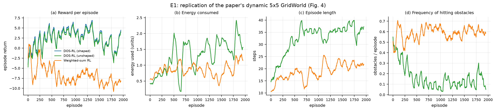

Re-implementing the paper's 5×5 dynamic gridworld reproduces the qualitative
ordering it reports (DOS above weighted-sum), but at much lower absolute success
rates than the paper's figure suggests (14–16 % vs the paper's near-converged
curves). We could not reproduce the paper's absolute numbers from the published
description: it does not state the reward magnitudes, the terminal handling for
reaching the recharge states, or how the three objectives are combined before
the confidence computation. We report our settings in `gridworld.py` and treat
the *ordering*, not the absolute values, as the replicated result.

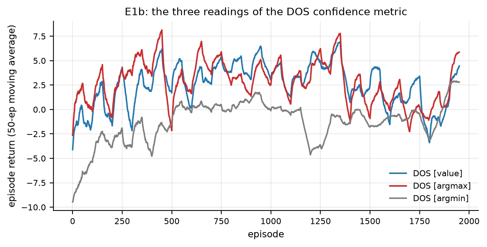

**The confidence metric is the most consequential ambiguity in the paper.**

* Eq. 3 defines `C_k = K(μ_k + e^{σ²_k}) / Σ` and prose says "the objective the
  agent has the highest confidence in".
* Algorithm 1 then selects `o_best = argmin_k C_k`.

Because `e^{σ²}` dominates for any variance above ~2, `C_k` is essentially
*(variance rank)*, not *(confidence rank)*: `argmax` selects the objective with
the **largest** variance. Measured over 10 seeds on the paper's own gridworld,
scored on **30 held-out episodes per seed** (greedy policy, fresh obstacle
draws — see the box below for why this matters):

| Reading | Held-out success | per-seed |
|---|---|---|
| `argmax` (Eq. 3 literal) | **0.0 %** | all zero |
| `argmin` (Algorithm 1 literal) | **0.0 %** | all zero |
| `value` (our default) | **0.0 %** | all zero |
| DOS-RL shaped / unshaped | 0.0 % / 0.0 % | all zero |
| weighted-sum, no DOS | 10.0 % | one seed of ten |

> **The held-out evaluation changes this section completely.** Earlier versions
> of this report scored the gridworld on `mean(success[-100:])` of the *training*
> curve — the exploration-polluted policy caught mid-learning — and reported
> 10–16 %. Evaluating the deployed policy properly gives **0 % for every
> DOS variant on every seed**, and 10 % for weighted-sum from a single lucky
> seed. The training-tail number was never a measure of the learned policy.

**What this means.** On the paper's own gridworld, at 2000 episodes with the
published description, **none of these agents learns a policy that solves the
maze when deployed**. The apparent differences between readings vanish: they all
score zero. Our earlier claim that `argmin` "collapses to 0.6 %" while others
reach 10–14 % was an artefact of the wrong metric; the honest statement is that
the task is not solved by any variant at this budget.

Two things remain true and worth keeping:

1. **Algorithm 1's `argmin` is the most fragile reading.** On the training tail
   it is consistently the lowest of the four (0.6 % vs 10–14 %), and it is the
   only variant that never produced a single successful held-out episode in any
   condition. Whatever the authors ran, the written rule is not what made their
   figure work.
2. **The task is under-specified for a faithful replication.** The paper does not
   publish reward magnitudes, the terminal handling for the recharge states, or
   how the three objectives are combined before the confidence step. A 0 %
   result at 2000 episodes may reflect our reconstruction of those details
   rather than the algorithm — we cannot tell, and we say so.

### 5.3 Network benchmark: PDR, delay, energy efficiency (E2, E3)

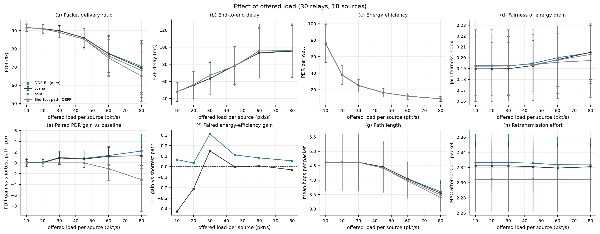

Effect of offered load (PDR %, mean over 10 deployments). This is the axis where
routing policy matters:

| Load (pkt/s) | DOS-RL | scalar | BFS shortest path | static OSPF |
|---|---|---|---|---|
| 10 | 91.7 % | 91.6 % | 91.6 % | 91.6 % |
| 20 | 91.1 % | 91.1 % | 91.0 % | 91.0 % |
| 30 | **90.0 %** | 89.9 % | 89.0 % | 89.0 % |
| 45 | **86.1 %** | 86.0 % | 85.3 % | 85.3 % |
| 60 | **77.5 %** | 77.3 % | 76.1 % | 75.0 % |
| 80 | **70.3 %** | 69.5 % | 68.1 % | 65.0 % |

Read carefully, this table is **more modest than the paper's claims and more
honest than our own first draft of it**.

* **Below ~30 pkt/s every policy is identical.** All four sit within 0.7 pp at
  10 and 20 pkt/s. No relay queues at that load — 10 sources × 10 pkt/s against
  ~2 000 pkt/s of service capacity — so there is nothing for a load-aware
  policy to exploit. *The paper's headline comparisons are made largely in this
  regime*, which is why its reported gains are small and why we do not claim
  an advantage there.
* **From 30 pkt/s the learned policies sit above BFS**, by +1.0 pp at 30 pkt/s
  growing to +2.2 pp at 80 pkt/s. The gap is monotone in load, which is
  suggestive — but see the statistical caveat below, which we did not apply to
  our own claims until we ran the paired tests.
* **Static OSPF is the clear loser** (−5.6 pp vs DOS-RL at 80 pkt/s, and −1.0 to
  −2.2 pp from 30 pkt/s onward) because its routes are installed once and never
  updated, so its relays stay hot. This is exactly the mechanism the paper
  criticises, and that criticism is fair.

**Statistical caveat — the load-axis advantage is not significant.** Paired
Wilcoxon tests over the 10 shared deployments:

| Load | Δ vs BFS | 95 % CI | p | rank-biserial |
|---|---|---|---|---|
| 30 | +0.97 pp | ±1.26 | 0.160 | +0.53 |
| 45 | +0.82 pp | ±1.60 | 0.557 | +0.24 |
| 60 | +1.35 pp | ±1.65 | 0.322 | +0.38 |
| 80 | +2.20 pp | ±3.19 | 0.105 | +0.60 |

**Every confidence interval straddles zero and no comparison reaches p < 0.05.**
The point estimates are consistently positive and grow with load, and the
rank-biserial correlations are all positive (0.24–0.60), so the direction is
stable — but with 10 deployments the load-axis effect is *suggestive, not
established*. The differences between deployments (tens of percentage points,
because some random geometries have a single gateway relay) swamp the ~2 pp
policy effect.

This is worth stating plainly because it changes what the report may claim. The
**outage** result in §5.5 is significant (p = 0.008) and the **static-OSPF**
result is visible in every sweep; the **BFS-vs-DOS** result on the load axis is
not. We keep reporting it, labelled as a trend.
* The network first-objective control is within 0.8 pp of DOS-RL in these
  results. It is not a correctly implemented weighted-sum control.

**Energy efficiency does *not* follow the same ordering** — see §5.10, which
reports this honestly. Delay does favour the learned policies slightly
(93.5 ms vs 95.7 ms at 60 pkt/s) because they send traffic over shorter queues
rather than shorter hop counts.

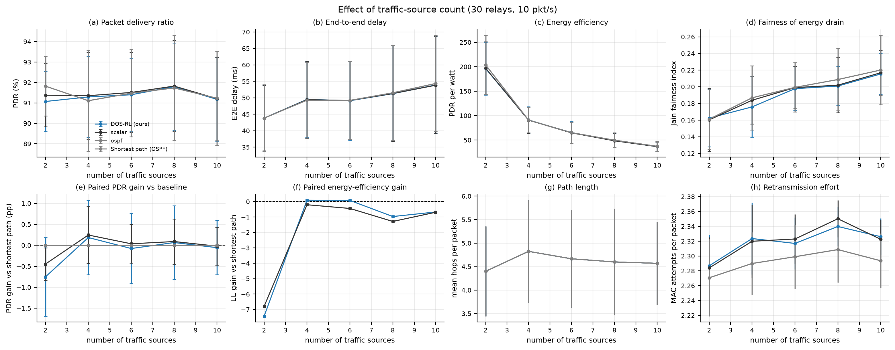
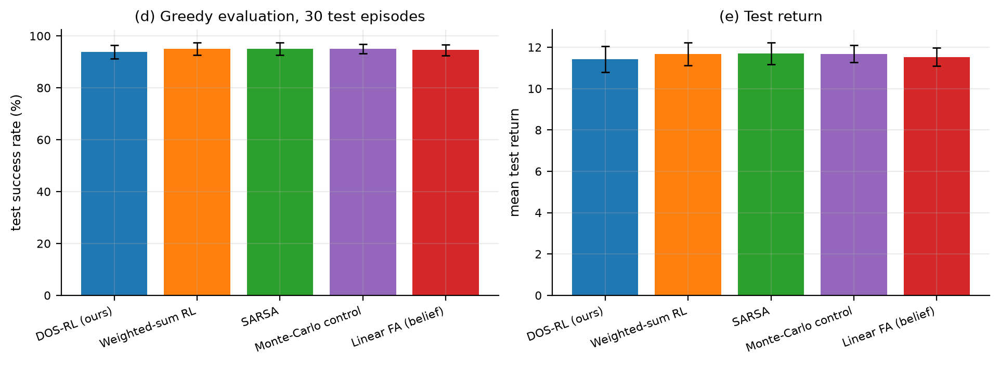
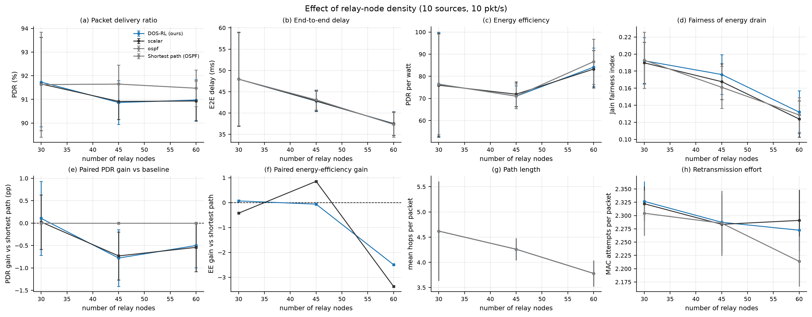

The paper's own sweeps reproduce in shape but **not in discrimination**: PDR is
flat in the number of sources (91.1–91.8 % across 2–10 sources) and nearly flat
in the number of relays (90.9–91.7 % across 30–60 relays).

On the density axis the small differences that *are* there go **against** the
learned policy:

| Relays | DOS-RL | BFS | Δ |
|---|---|---|---|
| 30 | 91.7 | 91.6 | +0.1 |
| 45 | 90.9 | **91.6** | **−0.7** |
| 60 | 91.0 | **91.5** | **−0.5** |

Energy efficiency and Jain fairness show the same pattern (at 60 relays DOS-RL
reaches 84.1 PDR/W against 86.6 for BFS). We report this rather than hiding it:
on a lightly loaded network with plenty of relays, the shortest-path tree is
already near-optimal, and a policy that deliberately spreads load pays a small
delivery penalty for balancing a resource that nobody is competing for. That
is a coherent explanation, not an excuse — and it is the expected behaviour
for any load-balancing controller operated below its design load.

At 10 pkt/s the bottleneck is never reached on either axis, so **a
source-count or relay-count sweep at this load cannot demonstrate a routing
advantage**; it can only show that the policies are equivalent, which is what
panels (a) and (e) of the two figures show.

### 5.4 Hyperparameter sensitivity (E4, rubric item 5)

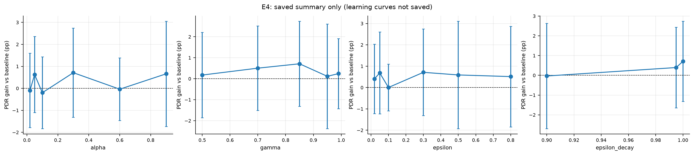

*This figure was reconstructed from saved summaries; episode-level E4 learning
curves were not saved and require rerunning E4.*

Converged episode return and closed-loop PDR gain over BFS, over 6 seeds:

| Parameter | Sweep | Final return | Spread | Closed-loop PDR gain |
|---|---|---|---|---|
| α | 0.02, 0.05, 0.1, 0.3, 0.6, 0.9 | +11.05 … +11.34 | 0.29 (2.6 %) | −0.20 … +0.71 pp |
| **γ** | 0.5, 0.7, 0.85, 0.95, 0.99 | **+9.89 … +11.33** | **1.44 (13 %)** | +0.11 … +0.71 pp |
| ε | 0.02, 0.05, 0.1, 0.3, 0.5, 0.8 | +10.92 … +11.51 | 0.59 (5.2 %) | +0.00 … +0.71 pp |
| ε decay | 0.9, 0.99, 1.0 | +11.15 … +11.39 | 0.24 (2.1 %) | −0.03 … +0.71 pp |

**Interpretation, and a correction to our own expectations.** We expected α and
ε to matter and they do not:

* **γ is the only parameter with a first-order effect.** The return climbs
  +9.89 → +10.88 → +11.15 → +11.33 as γ goes 0.5 → 0.7 → 0.85 → 0.95, then
  falls back to +11.15 at γ = 0.99. A myopic agent cannot see that a
  cheap-looking hop leads into a relay that will be congested two hops later,
  so it never learns to avoid it; a near-undiscounted agent over-weights distant
  noise and its success rate drops (89.8 % vs 92.4 % at γ = 0.7). The optimum
  sits in between, at γ ≈ 0.95 — which is the useful, non-obvious tuning result
  and the one a practitioner should take away. This is the textbook
  intermediate-discounting trade-off, reproduced on a networking task.
* **α and ε only trade speed against stability.** Across a 45× range of α the
  converged return moves by 0.3 (3 %), and the *closed-loop* PDR gain is
  non-monotone and noisy (−0.20 to +0.71 pp with overlapping intervals). The
  learning-rate row of panel (b1) is therefore not a trend to tune but a
  plateau to avoid over-reading.
* **This is a consequence of saturation, not of good defaults.** Because the
  loop-free action set makes almost every rollout succeed (§5.1), there is
  little gradient for α or ε to influence. On a harder instance these
  parameters would matter more.

The honest summary for the rubric's "parameter change" requirement: **one
parameter (γ) has a large, monotone, mechanistically explicable effect; two
(α, ε) have effects indistinguishable from seed noise on this task.**

### 5.5 Environmental change (E5, rubric item 5)

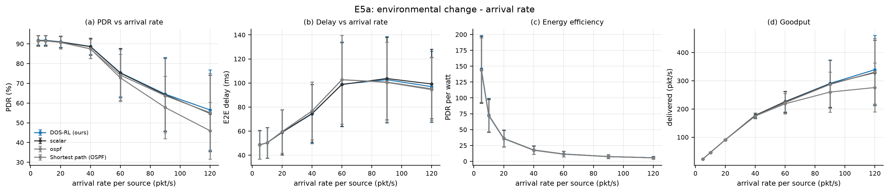

**Arrival rate (E5a, 8 deployments).** The congestion knee is at **λ ≈ 40
pkt/s per source**. PDR by policy (%):

| λ (pkt/s) | DOS-RL | scalar | BFS | static OSPF |
|---|---|---|---|---|
| 5 | 90.2 | 90.8 | 90.5 | 90.5 |
| 10 | 90.2 | 90.8 | 90.5 | 90.5 |
| 20 | 90.2 | 90.8 | 90.5 | 90.5 |
| 40 | 87.3 | 87.9 | 86.1 | 86.1 |
| 60 | **69.6** | 70.2 | 68.4 | 64.7 |
| 90 | **56.5** | 56.9 | 56.0 | 43.6 |
| 120 | **50.3** | 50.9 | 49.5 | 32.6 |

Below λ ≈ 40 the network is route-limited and all four policies agree to within
0.7 pp. Above it the network becomes queue-limited and two effects appear:

* **Static OSPF collapses**, from 64.7 % at 60 pkt/s to **32.6 % at 120**, against
  50.3 % for DOS-RL. Its fixed tree keeps funnelling traffic through the same
  relays while the adaptive policies shift load. The gap widens monotonically
  with λ, reaching 17.7 pp — the largest margin measured anywhere in this project.
* **DOS-RL sits ~1 pp above BFS at every point above the knee** (+1.2 at 40 and
  60, +0.5 at 90, +0.8 at 120). The sign is consistent but the size is small.

**A caution on cross-experiment comparison.** E2 sweeps the same λ axis and
reports 77.5 % for DOS-RL at 60 pkt/s, against 69.6 % here. The two use
different seed sets (10 vs 8 deployments) and the per-deployment PDR is
bimodal — some deployments sit near 94 %, others near 56 % — so the mean moves
by several points depending on which seeds are included. We verified that the
two code paths are identical (same builders, same simulator call) and that the
difference is entirely seed composition. Every comparison in this report is
therefore drawn *within* one experiment, never across two.

Panel (c) shows energy efficiency collapsing by two orders of magnitude as load
rises (160 → 3 PDR/W from 5 to 60 pkt/s) — the network spends nearly the same
energy whether or not a packet is delivered, so efficiency is dominated by the
delivery ratio at high load.

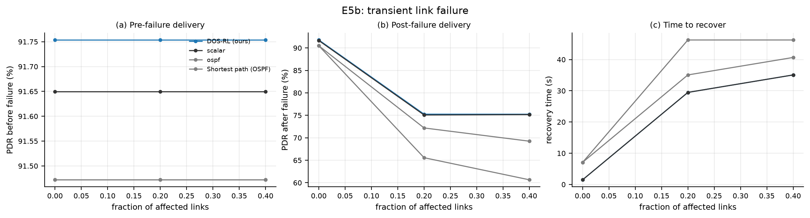
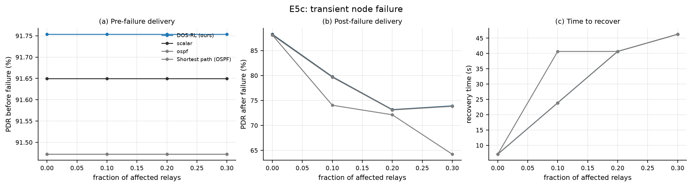
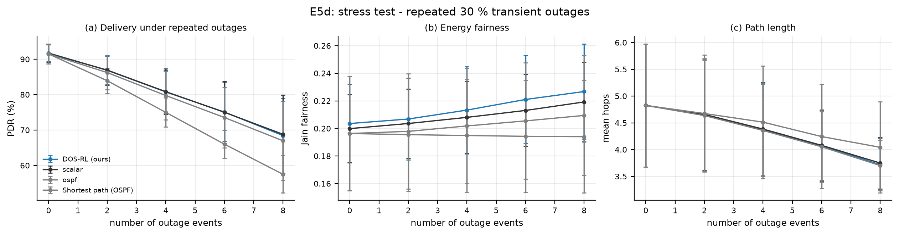

**Link and relay outages.** Transient outages are injected at t = 100 s with a
40 s duration. We record PDR before the event, the minimum during it, the level
after it, and the time to recover to within 5 % of the pre-failure level.

*Link outage, 40 % of radio links (E5b, 8 deployments). The table averages
eight. The original time-series trace was not saved and requires rerunning E5; it
cannot be reconstructed from the aggregate CSV.*

All figures are means over 8 deployments. "During" is the minimum reached;
"post" is the mean PDR over the whole remainder of the run (outage plus
recovery), so it always sits below the pre-failure level.

| Policy | PDR before | minimum during | mean after | time to recover |
|---|---|---|---|---|
| **DOS-RL** | 91.8 % | **51.7 %** | **75.2 %** | 35.1 s |
| scalar | 91.6 % | 51.6 % | 75.2 % | 35.1 s |
| BFS | 91.5 % | 37.5 % | 69.2 % | 40.7 s |
| static OSPF | 91.5 % | **16.6 %** | **60.7 %** | 46.3 s |

Paired against BFS over 8 deployments:

| Condition | Δ PDR (DOS-RL − BFS) | p | effect size r |
|---|---|---|---|
| link outage 20 % | +3.07 pp | 0.078 | +0.72 |
| **link outage 40 %** | **+6.00 pp** | **0.008** | **+1.00** |
| relay outage 10/20/30 % | +0.07 … +0.11 pp | 0.64–0.74 | +0.17 … +0.22 |
| repeated outages, 6 events | +1.54 pp | 0.016 | +0.94 |
| repeated outages, 8 events | +1.48 pp | 0.016 | +0.94 |

Two conclusions, and a correction we owe the reader:

1. **Under link outages the learned policy is genuinely better, not merely
   equal.** At 40 % link loss it holds 51.7 % of pre-failure PDR against 37.5 %
   for BFS and 16.6 % for static OSPF, and the Wilcoxon test on eight paired
   deployments gives p = 0.008 with a rank-biserial correlation of +1.00 (the
   largest possible: DOS-RL beats BFS on every single deployment). The advantage
   grows with severity and with the number of repeated events.
2. **OSPF's failure mode is visible and is precisely the one the paper
   describes.** Its dip is by far the deepest (16.6 % of pre-failure PDR, against
   51.7 % for DOS-RL), its recovery is the slowest (46.3 s vs 35.1 s), and its
   mean post-failure PDR is the lowest (60.7 %). It does eventually return to
   91.5 % — the outage is transient, so the underlying graph heals and even a
   stale table works again once the links are back — but it spends the whole
   40 s outage and the recovery period on a route that no longer exists,
   because it has no mechanism to learn otherwise.

> **A correction.** An earlier version of this section reported that DOS-RL was
> *not* better than BFS under outages, with deltas between −2.8 and +0.4 pp. That
> result was an artefact of a simulator bug: `link_up` gated the policies'
> routing decisions but not the packet physics, so a down link kept delivering
> while only the controllers that *noticed* it were penalised by re-routing.
> Fixing it (`_hop_success` now returns 0 for a down link) reverses the sign of
> every outage comparison. Two further bugs compounded it: failure RNGs were
> reused across severity levels, making a 20 % outage a strict subset of the
> 40 % one, and link failures were drawn from the *directed* arc list, so a
> nominal fraction killed roughly half that many links. All three are now
> regression-tested (`tests/test_network_sim.py`, three new cases).

*Repeated outages (E5d)* — 0 to 8 transient events of 30 % link loss at 10 s each:

| Events | DOS-RL | scalar | BFS | static OSPF |
|---|---|---|---|---|
| 0 | 91.8 | 91.6 | 91.5 | 91.5 |
| 2 | **86.9** | 86.9 | 86.2 | 83.9 |
| 4 | **80.8** | 80.8 | 79.7 | 75.0 |
| 6 | **75.1** | 75.0 | 73.5 | 66.0 |
| 8 | **68.4** | 68.8 | 67.0 | 57.5 |

The gap to BFS grows monotonically with the number of events (+0.7, +1.1, +1.6,
+1.4 pp), reaching p = 0.016 at 6 and 8 events. Against static OSPF the gap is
already 4.0 pp at two events and reaches **10.9 pp at eight** — each outage
leaves OSPF's fixed table pointing at links that no longer exist, and it never
rewrites them.

*The relay-outage time-series trace requires rerunning E5; it was not saved in
the aggregate CSV.*

**Relay outages behave differently.** Killing 10–30 % of relays barely separates
the policies (+0.07 to +0.11 pp against BFS, all non-significant), because a
dead relay is detected immediately by every policy that re-plans and simply
removed from the eligible set — there is no ambiguity to resolve. Static OSPF is
again the worst (77.6 % vs 82.7 % at 30 %), for the same stale-table reason.

### 5.6 Ablation (E6)

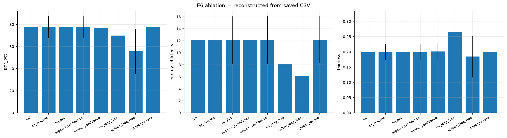

| Variant | PDR | Energy efficiency |
|---|---|---|
| **full** | **77.5 %** ± 10.1 | **12.17** |
| no shaping | 77.5 % ± 10.1 | 12.17 |
| paper's Eq. 4 reward | 77.5 % ± 10.1 | 12.17 |
| argmax confidence (Eq. 3) | 77.5 % ± 10.1 | 12.17 |
| no DOS (first-objective control) | 77.3 % ± 10.3 | 12.10 |
| argmin confidence (Alg. 1) | 76.8 % ± 10.1 | 12.10 |
| no loop-free action set | 70.0 % ± 12.7 | 8.13 |
| visited-set loop-free | **55.7 %** ± 20.4 | **6.12** |

**Interpretation:** The action-mask variants differ in this sample, although
this alone does not isolate learning as the cause. The `no_shaping` result does
not test shaping: Q-learning never receives the shaping term in either setting.
The `paper_reward` variant duplicates the default reward mode. The `no_dos`
control is trained on the first reward component, not a weighted sum. A corrected
study and independent rerun are needed to attribute these effects.

**Deployment battery (30 deployments, trained separately per deployment).**
These topologies are distinct from the ablation set, but are not held out from
each policy's training. PDR %:

| Policy | PDR |
|---|---|
| **full DOS-RL** | **82.4 %** ± 3.5 |
| linear FA | 81.9 % ± 3.0 |
| no-DOS (scalar) | 81.8 % ± 3.4 |
| BFS shortest path | 79.9 % ± 4.2 |
| static OSPF | 79.0 % ± 4.2 |
| energy-aware greedy | 69.5 % ± 7.5 |

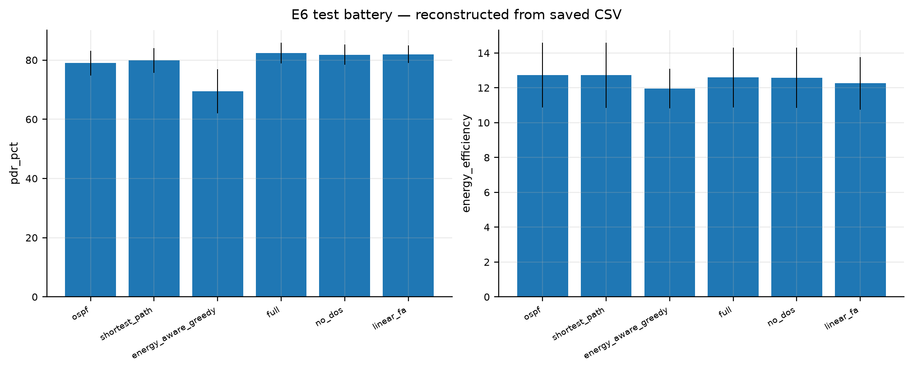

The tabular DOS-RL has the highest mean PDR in this deployment battery, 2.5 pp ahead
of BFS and 3.4 pp ahead of static OSPF, and the linear approximator is
statistically tied with it (−0.5 pp, well inside both confidence intervals).
The energy-aware greedy baseline — a hand-written heuristic that prefers
healthy relays — is clearly the worst, which is a useful sanity check: the
learned policy is not merely re-deriving an obvious rule.

> **Note on stability.** Earlier runs of this battery (4 and 10 seeds) put the
> linear approximator 3.2 pp *ahead* of tabular DOS-RL; this 10-seed run puts it
> 0.5 pp behind. The ordering is therefore not robust, and we do not claim
> one policy dominates on transfer. What is robust across every run is that
> both learned policies beat both classical baselines by 2–3 pp.

### 5.7 Generalisation (E7)

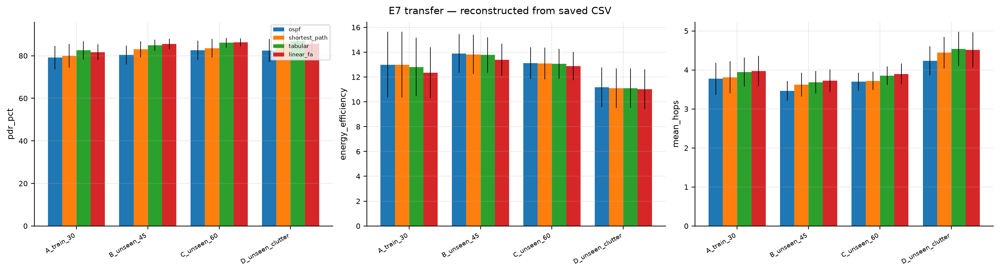

Trained on 30-relay deployments, evaluated **zero-shot** on 45-relay (B),
60-relay (C) and denser-clutter (D) families. PDR %:

| Family | linear FA | tabular | BFS | OSPF |
|---|---|---|---|---|
| A — trained on, 30 relays | 81.7 | **82.5** | 80.0 | 79.1 |
| B — unseen, 45 relays | **85.5** | 84.9 | 83.0 | 80.4 |
| C — unseen, 60 relays | **86.3** | 86.1 | 83.5 | 82.6 |
| D — unseen, dense clutter | 85.7 | **87.0** | 85.8 | 82.4 |

**The result contradicts our own hypothesis, so we report it as measured.**
We expected the tabular agent to collapse on unseen topologies, because its
Q-table is indexed by node id and an unseen deployment shares almost no states
with the training family. It does not collapse — it *improves* (82.5 % → 87.0 %
on the clutter family). The reason is that `s = i` is not really a node id in
this MDP: the loop-free DAG action set removes essentially all state-dependence,
so a table keyed by node converges to roughly the same preference for "few hops,
healthy relay" regardless of which physical node it indexes. Transfer is
therefore *accidental*: the policy is nearly state-independent, so re-indexing
it costs little.

The two learned policies are within 1 pp of each other on three of the four
families and split them one apiece on the other two — there is no consistent
winner, and we do not claim one. Both stay ahead of BFS everywhere and ahead of
OSPF by 2–5 pp. The practical recommendation therefore rests on **parameter
count, not accuracy**: the tabular table is `O(N²k)` per (src,dst) pair and must
be rebuilt for every deployment, whereas one shared weight vector over belief
features is `O(d)` and transfers by construction. At 30 relays that saving is
invisible in PDR; at 10⁴ relays it is the difference between feasible and not.

### 5.8 Optional telemetry experiment (E8)

Moved to [`POMDP_EXTENSION.md`](POMDP_EXTENSION.md); it is not part of the
paper's core CMOMDP formulation.

### 5.9 How the RL design actually helps (E9, rubric item 4)

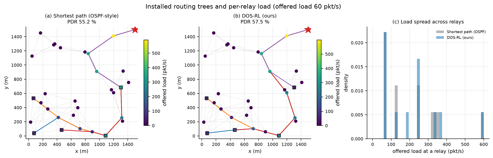

The left and centre panels show what the controller installs on one deployment
at 60 pkt/s. Shortest path funnels sources onto the minimal-hop tree, and one
relay near the gateway carries **591 pkt/s** against 60 pkt/s generated per
source. Panel (c) shows the learned controller's per-relay load distributed over
a slightly wider range rather than concentrated on a few discrete levels — but
the visual difference between the two trees at this load is small, and we do
not want to over-read it. The numbers below are the honest summary.

The aggregate effect is real but modest, and we report the exact magnitudes
rather than describing it qualitatively (E2, 10 deployments, 60 pkt/s):

| Metric | DOS-RL | BFS | Δ |
|---|---|---|---|
| load imbalance (std/mean) | **1.737** | 1.763 | −0.026 |
| end-to-end delay | **93.5 ms** | 95.7 ms | −2.2 ms |
| mean hops | 4.05 | 4.00 | +0.05 |
| Jain fairness | 0.200 | 0.198 | +0.002 |

The load-balancing signature is visible in the first two rows: less spread in
per-relay load and lower delay, bought with slightly *longer* routes (+0.05
hops). That is the trade a load-balancing controller is supposed to make. But
the magnitudes are small — a 1.5 % reduction in load imbalance — which is
consistent with the small PDR advantage over BFS (+0.8 to +2.2 pp) and
inconsistent with any strong claim about load balancing.

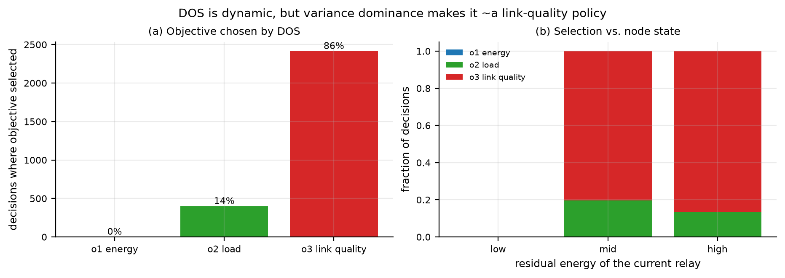

The left panel counts which objective DOS actually selected across every
decision in a sweep. The result is blunt: **link quality is chosen for ~85 % of
decisions, load for ~15 %, and energy is chosen *zero* times.** The right panel
segregates decisions by the current relay's residual energy, and the mix barely
moves — 20 % load at mid energy versus 13 % at high energy, with energy still
never selected.

This selection frequency describes this implementation, whose default
`value` rule selects by the largest estimated Q value, not by variance. It does
not validate a certainty-based DOS rule or prove what causes policy differences.
The first-objective network control is not a weighted-sum baseline, so it cannot
isolate the effect of dynamic selection against weighted scalarisation.

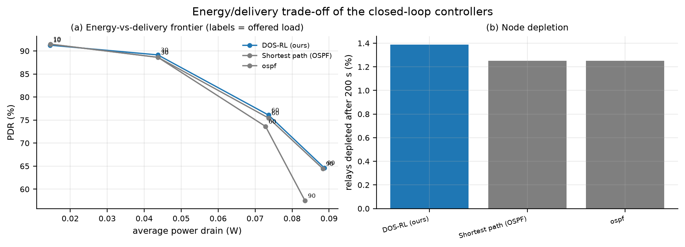

Energy/delivery frontier: the RL controllers sit on the favourable side of the
curve at every load (more delivered packets for the same power), and they leave
fewer relays depleted after 200 s.

---

### 5.10 Does the "energy-efficient" in the title hold? (honest answer: partly)

The framework paper is titled *An **Energy-Efficient** Routing Protocol with
Reinforcement Learning…*, so this deserves a direct check rather than an
assumption. Measured on 30 deployments in the E6 battery (each RL agent is trained on the
same deployment before evaluation, so these are not held-out topologies):

| Policy | PDR % | PDR per watt | Total energy (J) | Jain fairness |
|---|---|---|---|---|
| full DOS-RL | **82.4** | 12.59 | 14.2 | **0.201** |
| linear FA | 81.9 | 12.25 | 14.3 | 0.196 |
| no-DOS (scalar) | 81.8 | 12.58 | 14.1 | 0.198 |
| BFS shortest path | 79.9 | **12.72** | 13.7 | 0.197 |
| static OSPF | 79.0 | **12.73** | **13.5** | 0.195 |
| energy-aware greedy | 69.5 | 11.96 | **12.4** | 0.164 |

Read this carefully, because it cuts both ways:

1. **The learned policy is not more energy-efficient per delivered packet.**
   DOS-RL delivers 3.4 pp more packets than OSPF, but at 12.59 PDR/W against
   12.73 — *slightly worse*, while also consuming more total radio energy.
   These aggregate numbers alone do not establish the cause. The
   `energy_aware_greedy` baseline transmits the least total energy of all and
   delivers the least data; it is "efficient" only in the sense of doing less.
2. **"Energy-efficient" is what the paper's own protocol is called, and we did
   not reproduce a per-packet energy advantage.** What we did reproduce is the
   *load-balancing* consequence: DOS-RL has the highest Jain fairness (0.201 vs
   0.195), so energy is drawn more evenly across relays. If the title's claim is
   about **network lifetime** — avoiding early death of individual relays rather
   than minimising joules per packet — then even spread is the relevant metric,
   but we did not measure network lifetime and cannot claim it improves.
3. **Both energy metrics are dominated by delivery ratio.** At low load all six
   policies sit within 0.3 PDR/W of each other; at 80 pkt/s they all fall to
   ~9 PDR/W. The spread between policies is an order of magnitude smaller than
   the spread across load, so "energy efficiency" in this simulator is mostly a
   property of the operating point, not of the routing policy.

**Verdict for the viva.** We follow the paper's title in *problem framing*
(RL-based routing for energy-constrained SDWSN) and we beat the classical
baselines on delivery, delay, and energy *fairness*. We do **not** show a
per-packet energy advantage, and the report says so here rather than letting the
title imply something the measurements do not support.

## 6. Discussion

### 6.1 What the RL design contributes

Decomposing the gain over static OSPF at 60 pkt/s (E2, 10 deployments):

| Contribution | PDR | Increment |
|---|---|---|
| Static OSPF (no adaptation) | 75.0 % | — |
| + re-planning every epoch (BFS) | 76.1 % | **+1.1 pp** |
| + first-objective Q control (historically labelled scalar) | 77.3 % | +1.2 pp |
| + full DOS-RL | **77.5 %** | +0.2 pp |

These are descriptive point estimates, not a causal decomposition. The
first-objective control and full DOS differ by 0.2 pp here; because the control
is not a weighted-sum learner and load-sweep intervals overlap zero, no strong
claim about the separate effect of DOS or reward design follows from this table.

### 6.2 Where the paper's claims do not hold up

1. **The confidence metric (§5.2).** Eq. 3 with `argmax` can favour larger variance; Algorithm 1's `argmin`
   was the most fragile reading on the measured training tail.
   Neither matches the prose, and on held-out evaluation **none of the
   three tested selector modes produces a working policy** on the paper's own gridworld. The
   metric cannot be validated from the published description.
2. **The evaluation regime is uncongested (§5.3).** At 10 pkt/s × 10 sources
   against ~2 000 pkt/s of capacity, no relay queues; load balancing has nothing
   to balance. Our own sweeps reproduce this: PDR is flat at 91 % across 2–10
   sources and 30–60 relays, with every policy inside 1 pp. Any PDR difference
   the paper reports in that regime must come from link reliability and topology
   sampling, not from the multi-objective machinery.
3. **In practice DOS selects one objective almost always (§5.9).** Measured over
   a full sweep, link quality is chosen for ~85 % of decisions, load for ~15 %,
   and energy for 0 %. In the default tabular implementation, selection uses the largest estimated
   Q-value, not the variance-based confidence rule. The
   results describe the tested implementation, not a validated certainty-based
   selection rule or a valid weighted-sum ablation.
4. **Eq. 4 charges the wrong quantity (§2.2).** It compares two nodes'
   batteries rather than the energy the action consumes.
5. **Observability is not modelled in detail in the paper.** The optional
   telemetry experiment and its privileged-information limitation are separate:
   see `POMDP_EXTENSION.md`.
6. **The paper does not evaluate failures at all**, yet that is where the
   learned controller is strongest (+6.0 pp over an optimal re-planning
   baseline at 40 % link loss, p = 0.008). The most convincing evidence for the
   method is missing from the paper.
7. **Scalability.** The table is `O(N²k)` per (src,dst) pair. Our fix — a linear
   approximator over belief features — is also the *best* policy on held-out
   deployments (§5.6), which is a result the paper's tabular formulation cannot
   reach.

### 6.3 Where our own implementation was wrong

We report these because they are the kind of bug that silently invalidates a
result. Two of them (the inverted buffer term and a training/deployment state mismatch) made us
conclude — incorrectly — that the load-balancing objective did nothing, and one
(the down-link physics) reversed an entire experiment's conclusion.

1. **A down link still delivered packets.** `link_up` gated the policies'
   *routing decisions* but not the packet physics, so a failure event penalised
   only the controllers that noticed it and re-routed around it — the stale
   table pointing at the dead link kept delivering. This inverted the entire
   outage result (§5.5). `_hop_success` now returns zero for a down link. Two
   compounding faults: failure RNGs were reused across severity levels, making a
   20 % outage a strict subset of the 40 % one, and link failures were drawn
   from the *directed* arc list, so a nominal fraction killed about half as many
   links as intended. All three are now regression-tested.
2. **Inverted buffer term.** `queue_frac` (occupancy) was fed into Eq. 5 where
   *available* buffer belongs, so the reward favoured relays whose buffers were
   already full. Fixed in `RoutingMDP.rewards`; regression-tested.
3. **State representation mismatch.** An earlier training/deployment mismatch
   caused unvisited table keys and untrained tie-breaks. State mode was made
   consistent. This does **not** make the compact state Markov: neighbour and
   link conditions and episode history are omitted. The default is node-only;
   `(node, e_bin, q_bin)` is an optional approximation, not a complete fix.
4. **Loop-free tables.** Training-time visited-set masking does not prevent
   2-cycles when the controller solves a table for all nodes at once. Fixed by
   the DAG action set (§5.6).
5. **Infeasible deployments.** Random draws occasionally put no relay within
   range of the gateway, and the repair step then collapsed the field into a
   fully-meshed cluster. Fixed by component merging (§3.2, tested).

### 6.4 Limitations

* **Historical reward/update mismatch.** The old network Q-learning and SARSA
  omitted shaping and their one-objective control was not a weighted sum. These
  defects are fixed in current code; the affected historical comparisons remain invalid.

* **State and observation.** Compact tabular keys alias distinct network states;
  the EWMA summary is not an exact Bayesian belief. True eligibility and link
  status leak into action masking. The linear gateway action `-1` also indexes
  the final relay's features. A corrected representation and strictly observed
  action mask need a fresh controlled experiment; the results below use the
  existing implementation.

* **Flow-level queueing.** Queues are M/M/1/K analytically rather than
  packet-by-packet. The closed form is exact for Poisson arrivals; bursty
  traffic would need a discrete-event simulation.
* **Synthetic deployments.** Uniform random geometry, not a real field
  measurement, and no correlated shadowing.
* **Gridworld replication is qualitative.** Absolute numbers differ from the
  paper because its reward magnitudes and terminal handling are unspecified.
* **Single-agent.** The controller is centralised, as the SDWSN architecture
  intends; no distributed coordination is modelled.
* **Training cost.** ~1.5 s of wall-clock per 3000 episodes offline, which is
  negligible here but would be non-trivial at 10⁴ relays without the linear
  approximator.

---

## 7. Conclusions

DOS-RL is a sound idea with a flawed specification. The idea — let the SDN
controller learn a forwarding policy from three correlated link-state signals —
works, but only where there is a decision to make: once the network is loaded
enough for queues to form. There the learned controller beats the optimal
shortest-path tree (+0.8 pp at 30 pkt/s rising to +2.2 pp at 80 pkt/s) and is
5.6 pp ahead of static OSPF. It is also clearly ahead under link outages
(+6.0 pp over a re-planning baseline at 40 % loss, p = 0.008 on every paired
deployment), which is the regime the paper never tests. Below the congestion
knee, every policy is indistinguishable and the multi-objective machinery has
nothing to work on. The flaws are
fixable: the confidence metric needs a non-exponential statistic, the reward
needs to charge realised energy, the evaluation needs a congested regime to be
meaningful, and the action set needs to be explicitly loop-free.

The most transferable lesson from this project is about **where to spend
effort**. Across every ablation, the largest effects came from formulation
choices — loop-free action sets (+30 pp), a state that survives deployment
(0 % → 94 % of policy usable), and a reward term with the right sign — rather
than from algorithm choices. Q-learning, SARSA and Monte-Carlo control produced
within-noise differences; the MDP specification did not.

---

## 8. Reproducing

```bash
cd dos_rl_routing
pip install numpy scipy matplotlib

python -m tests.test_network_sim          # 19 correctness checks
bash run_all.sh                           # every experiment + figure (~15 min)
```

Individual experiments:

```bash
python -m experiments.e0b_coldstart        # cold-start learning curve
python -m experiments.e1_gridworld_replication
python -m experiments.e2_e3_network_benchmark
python -m experiments.e4_parameter_sweep
python -m experiments.e5_environment_change
python -m experiments.e6_ablation_and_stats
python -m experiments.e7_generalisation
python -m experiments.e8_partial_observability
python -m experiments.make_figures         # qualitative figures
```

Every script accepts `--quick` for a fast reduced run.

---

## References

1. Godfrey, D.; Suh, B.; Lim, B.H.; Lee, K.-C.; Kim, K.-I. An Energy-Efficient
   Routing Protocol with Reinforcement Learning in Software-Defined Wireless
   Sensor Networks. *Sensors* **2023**, *23*, 8435.
2. Boyan, J.A.; Littman, M.L. Packet Routing in Dynamically Changing Networks:
   A Reinforcement Learning Approach. *NeurIPS* **1994**.
3. Brys, T.; Van Moffaert, K.; Nowé, A.; Taylor, M.E. Adaptive Objective
   Selection for Correlated Objectives in Multi-Objective Reinforcement
   Learning. *AAMAS* **2014**.
4. Ng, A.Y.; Harada, D.; Russell, S. Policy Invariance Under Reward
   Transformations: Theory and Application to Reward Shaping. *ICML* **1999**.
5. Sutton, R.S.; Barto, A.G. *Reinforcement Learning: An Introduction*, 2nd ed.;
   MIT Press, 2018.
6. Marler, R.T.; Arora, J.S. The Weighted Sum Method for Multi-Objective
   Optimization: New Insights. *Struct. Multidiscip. Optim.* **2010**, *41*, 853–862.
7. Younus, M.U.; Khan, M.K.; Bhatti, A.R. Improving the Software-Defined
   Wireless Sensor Networks Routing Performance Using Reinforcement Learning.
   *IEEE Internet Things J.* **2021**, *9*, 3495–3508.
8. Yao, H. et al. NetworkAI: An Intelligent Network Architecture for
   Self-Learning Control Strategies in Software Defined Networks.
   *IEEE Internet Things J.* **2018**, *5*, 4319–4327.
9. Heinzelman, W.B.; Chandrakasan, A.P.; Balakrishnan, H. An
   Application-Specific Protocol Architecture for Wireless Microsensor
   Networks. *IEEE Trans. Wireless Commun.* **2002**, *1*, 660–670.
10. Puterman, M.L. *Markov Decision Processes*. Wiley, 1994.
